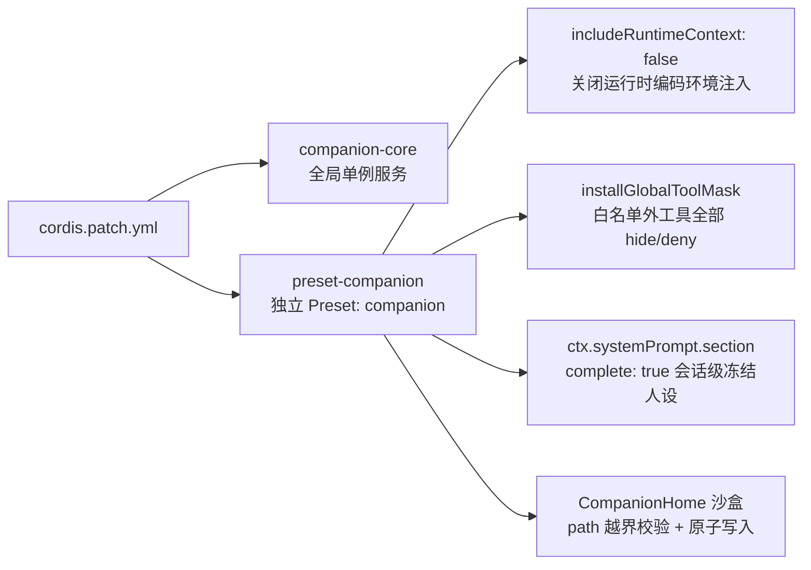
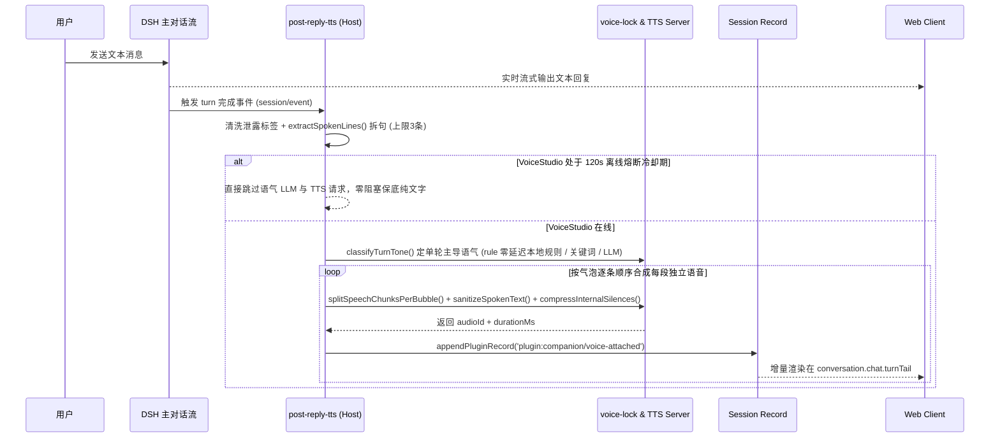
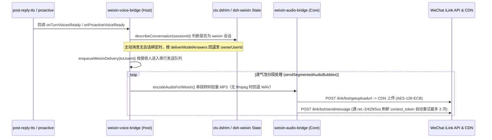

> [!IMPORTANT]
> 本文仅记录通用的插件工程架构、DSH 扩展机制、调度算法与排障经验。文中所涉角色名称、目录路径、音色 ID、会话 UUID 等均已脱敏为通用占位符（如 `<CompanionName>`、`<CompanionHome>`、`<VOICE_ID_DEFAULT>`）。

---

## 1. 背景与核心设计目标

DeepSeek Harness（以下简称 **DSH**）原生是一个面向编程、文件操作与工具调用的智能体宿主（Host + Web Client）。如果要将其改造成一个**高沉浸感、低延迟、具备长期记忆与主动关怀能力的 AI 伴侣系统**，不能只是简单写一段 System Prompt，否则会立刻遇到五个工程难题：

1. **工作区与身份串台**：代码仓库里的工具（文件读写、Shell、Git）与工作区提示词会破坏陪伴对话的沉浸感，且伴侣记忆不应绑死在某个代码目录下。
2. **上下文注入导致“底稿泄露”**：如果采用每轮动态注入 `<system-reminder>` 或可变 `runtimeContext`，随着轮次增加或记忆刷新，模型可能在回复中把底层人设、路径甚至音色列表原文复读出来。
3. **语音合成阻塞首字响应**：直接串行等 TTS 合成完再输出文字，会让聊天体验变得迟钝；同时需要支持多情绪音色组锁定（固定音色角色 + 按句切换情绪语气），而不能每句话依赖大模型显式调用工具。
4. **主动发消息机械且错位**：定时固定间隔弹窗极易打扰用户、造成未读轰炸；而主动消息写入聊天流时若锚点顺序处理不当，还会插入到上一轮回复文本与底部操作图标之间，导致 UI 错乱。
5. **前端语音交互体验**：需要微信风格的紧凑语音条、未读红点、仅首次点击连续自动连播以及与日常对话融为一体的时间线布局。

基于上述目标，我们设计并落地了独立插件 `@local/dsh-companion`，整体采用 **Core（纯 Node 无框架业务逻辑） / Host（Cordis 服务与事件桥接） / Client（Web UI 槽位注入）** 三层解耦架构：

```text
packages / @local/dsh-companion
├── package.json                       # 声明 dsh.bundle.patch 与 dsh.client 入口
├── cordis.patch.yml                   # 挂载 companion-core 与隔离态 preset-companion
├── patches/
│   └── dsh-im-companion-pacing.mjs    # @xmanrui/dsh-im 可备份/可回滚源码补丁（防抖/Typing 保活/分泡发信）
├── src/
│   ├── core/                          # 纯 Node 业务逻辑（可脱离 DSH 独立单测）
│   │   ├── companion-store.js         # CompanionHome 沙盒 Markdown 记忆、跨会话流水与 Dream Consolidation
│   │   ├── companion-state.js         # 伴侣内在日常状态机（按时段维护作息/心情/话欲，1.2h 动态刷新）
│   │   ├── companion-text-pipeline.js # 微信标准表情、splitCompanionDisplayBubbles 分泡、动作剥离与 TTS 净化
│   │   ├── lorebook.js                # 世界书关键词/正则按需唤醒、events 自动索引与 stickyTurns
│   │   ├── moments-store.js           # 后台生活碎碎念归档与捏造线下见面幻觉拦截
│   │   ├── voice-lock.js              # 角色音色组/多组切换锁定 & 关键词兜底
│   │   ├── reply-tts-helpers.js       # 回复清洗、分句、规则零延迟选音（rule mode）与单轮主导语气解析
│   │   ├── tts-pronunciation.js       # 口语数字/时间/缩写规范化与疑似多音字检测
│   │   ├── tts-client.js              # TTS 串行队列客户端（汉字断句清洗、429 退避重试、瞬时 5xx 与 120s 熔断）
│   │   ├── wav-utils.js               # WAV 头解析、WSOLA atempo 变速、异常静默压缩、响度均衡与拼接
│   │   ├── audio-store.js             # 音频缓存与 HTTP Range 断点续传响应
│   │   ├── proactive-engine.js        # 拟人主动消息调度引擎（轻追问必发、话欲倍率、deferCheckIn 与状态持久化）
│   │   └── weixin-audio-bridge.js     # ffmpeg MP3 转码与 iLink 加密上传（含 ret:-2 自动刷新 token 重试）
│   ├── host/                          # DSH Cordis 插件层
│   │   ├── index.js                   # 注册 companion 服务、热更新签名、/api/companion.* 路由与微信节奏/语音桥
│   │   ├── preset-scope.js            # 冻结 System Prefix + 动态 Suffix（时间/内在状态/Lorebook）与记忆工具
│   │   ├── post-reply-tts.js          # 串行回合 TTS 队列、按气泡独立合成语音并流式回传前端与微信桥
│   │   ├── pronunciation-rewriter.js    # 面向 TTS 音频的多音字静默纠偏改写器（不改原文显示）
│   │   ├── proactive.js               # 后台 60s 轮询、自主 SKIP、Dream 提炼、Moments 与回溯锚定
│   │   ├── weixin-pacing-bridge.js    # 微信 10s/25s 入站防抖、15~25s 出站延迟与按 (sessionId, turn) 门闩隔离
│   │   └── weixin-voice-bridge.js     # 注入 dshIm/credentials、按接收人串行队列与逐气泡分段语音投递
│   └── client/                        # DSH Web 前端扩展
│       └── client.js                  # 微信风语音条、主动图文/纯文降级节点、微信表情同步、分泡渐进与连播控制
└── tests/                             # Node 原生单元测试套件（10 个文件共 70 项用例）
    ├── bundle-and-client.test.mjs
    ├── companion-store.test.mjs
    ├── companion-text-pipeline.test.mjs
    ├── lorebook-and-moments.test.mjs
    ├── post-reply-tts.test.mjs
    ├── proactive-engine.test.mjs
    ├── tts-pronunciation.test.mjs
    ├── voice-lock-and-tts.test.mjs
    ├── weixin-audio-bridge.test.mjs
    └── weixin-pacing-bridge.test.mjs
```

---

## 2. 四重隔离架构：把“编码工具链”彻底关在伴侣空间之外

为了让伴侣会话既能独立沉淀长期记忆，又绝不会意外执行代码工具或泄露编码上下文，系统在配置与运行时做了四层隔离：



### 2.1 `cordis.patch.yml` 隔离式 Preset 编排

在 `cordis.patch.yml` 中，通过专门的 `preset-companion` 挂载 `@local/dsh-companion/preset-scope`：

- `id: companion`：在 DSH UI 中成为独立 Preset；
- `includeRuntimeContext: false`：关闭 DSH 默认的运行时环境摘要注入；
- 显式声明仅挂载轻量基础组件（如 `dsh-tool-web`、`compaction-basic`、`command-compact`），**移除了原生 `@deepseek-ai/dsh-persona` 与重型代码工具包**，避免两者互相注入冲突提示词。

### 2.2 工具全局白名单屏蔽 (`installGlobalToolMask`)

在 `src/host/preset-scope.js` 中，除了关闭不需要的默认上下文外，还通过工具过滤钩子显式屏蔽非伴侣工具：当处于 `companion` Preset 作用域时，仅放行 5 个专属伴侣记忆/提醒工具及必要的搜索工具，其余文件系统、终端命令、代码编辑工具一律不可见。

### 2.3 CompanionHome 独立便携记忆仓库 (`src/core/companion-store.js`)

伴侣的灵魂设定与记忆全部以可读、可迁移、版本友好的 **Markdown + JSON Manifest** 形式保存在独立目录 `<CompanionHome>` 中，与任意开发工作区解耦：

- `companion.manifest.json`：角色名、音色锁定配置、主动消息参数、TTS 服务配置；
- `SOUL.md` / `IDENTITY.md`：核心性格、说话节奏与身份设定；
- `USER_PROFILE.md` / `MEMORY.md`：用户画像与长期核心记忆；
- `REMINDERS.md`：用户约定或待提醒事项；
- `memory/daily/` 与 `memory/events/`：按日日记与重要纪念事件；
- `voice-assets/`：与该角色绑定的参考音频资产占位说明。

工程安全细节：

- **路径沙盒校验 (`resolveSafePath`)**：所有读写先做 `path.resolve` 与相对前缀校验，拒绝 `..` 路径穿越；
- **原子写入**：先写临时 `.tmp` 文件再 `rename` 覆盖，防止并发写入或断电损坏档案；
- **自动脚手架初始化**：首次启动若目录为空，自动生成模板骨架，保证开箱即用。

### 2.4 五个伴侣专属工具

模型只通过以下 5 个语义化工具维护长期记忆与日程，无需接触底层路径：

| 工具名                | 用途                           | 落盘位置                        |
| :-------------------- | :----------------------------- | :------------------------------ |
| `memory_log_daily`    | 记录当天相处片段与情绪日记     | `memory/daily/YYYY-MM-DD.md`    |
| `memory_record_event` | 记录里程碑或特殊纪念事件       | `memory/events/*.md`            |
| `memory_update_core`  | 沉淀需要长期记住的偏好或事实   | `USER_PROFILE.md` / `MEMORY.md` |
| `memory_recall`       | 按关键词检索历史日记与记忆文件 | 只读检索                        |
| `companion_reminders` | 新增、勾选或查询待办提醒       | `REMINDERS.md`                  |

### 2.5 聊天记录保存与跨对话记忆边界

在实际使用（含 Web 桌面端与 IM 渠道 `/new` 重建会话）中，需要区分**当前会话上下文**与**跨对话长期记忆**两层机制：

1. **同一会话的完整原话保存**：无论是桌面端会话还是 IM 渠道绑定的固定会话，只要不主动新建对话或发送 `/new`，所有往来消息均持久化在 DSH 会话日志中，重启后继续同一会话仍可看到完整历史（长对话由 `compaction-basic` 自动摘要延续）。
2. **跨会话加载与热后缀双轨机制**：
   - **冻结前缀 + 动态后缀（`prefix` / `suffix`）**：为防止反复改写主提示词触发 DSH `<system-reminder>` 泄露，主设定与核心记忆快照放入冻结的 `deployment:persona-prefix`（`complete: true`）；与此同时，通过每轮动态求值的 `deployment:persona-suffix` 安全注入**真实当地星期与时间、伴侣内在小状态（`CompanionInnerState`）以及核心档案变更热快照**（基于正文签名比对，一旦会话内更新了 `SOUL.md`/`MEMORY.md`/`USER_PROFILE.md` 立即生效，无需重启或 `/new`）。
   - **加载配额与检索**：启动时默认加载最近 **5 天**（`recentDailyFiles: 5`，预算上限 `12000` 字符）的每日记忆；更早的日常片段与 `memory/events/` 故事由模型在拿不准旧事、歌曲或约定前先静默调用 `memory_recall` 核对。
3. **切断“主动搭话污染日记”的反馈环 + 跨会话流水 + 夜间 Dream Consolidation**：
   - 早期每次主动消息都会被逐字写入 `memory/daily/YYYY-MM-DD.md`，导致模型把高频追问模板当成上下文 Few-Shot 反复模仿。现已改造为：**主动搭话通过 `store.logProactive()` 独立落盘到 `memory/proactive-log.md`**（不进入日常聊天 `DAILY` 上下文窗口）；
   - 同时在 `CompanionStore` 内新增跨 `/new` 对话流水归档（`appendTranscriptTurn` 写入 `memory/transcripts/YYYY-MM-DD.md`）与 `consolidateDaily()` / `consolidateAllDaily()`，并在后台闲时静默运行 **Dream Consolidation**（`listPendingDreamTranscripts` / `saveDreamConsolidation`），自动提炼关键情绪与约定沉淀到 `memory/daily/*.md` 并去重，确保新建会话也不失忆。

### 2.6 去 AI 八股文与“活人感”弹性聊天节奏

早期实践发现，“强迫每轮固定配额 + 结尾吊二选一问句”或反过来把单句短回设成“一言不发式惜字如金”，都会破坏真人恋爱感——要么像客服，要么变成一问一答的冷漠机器。经过两轮迭代，我们将 `SOUL.md` 与 `cordis.patch.yml` 的表达准则重构为四条平衡铁律：

1. **有来有往的 2~3 泡对话流**：大多数日常接话、斗嘴、聊近况时自然换行拆为 **2~3 条有呼吸感的口语短气泡**（先把眼前的梗接实，再补自己的念头/生活碎片，或带着好奇反撩一句把话头延续下去），仅在简单附和/叹气时落定为 1 句短回；
2. **自然克制的反问率**：禁用“先夸奖、再脑补、最后强迫二选一问卷”的客服三段式，大部分回合自然收尾留白或顺势接茬，拒绝机械审讯感；
3. **禁用镜像复述与说教惯性**：禁止用双引号/破折号原样复述对方刚说过的话，禁止循环催促“喝水/看冰箱/早点睡”，禁止“不过话说回来/值得一提的是”等书面转折腔；
4. **引入独立内在生活状态机（`src/core/companion-state.js`）**：按凌晨/上午/中午/下午/傍晚/深夜 6 个时间窗每 **1.2 小时（`slotDurationMs`）** 刷新伴侣自己的日常动作、心情与话欲（`socialDesire: low | normal | high`），在保持独立生活呼吸感的同时避免长时间锁死在低话欲冷场状态。

### 2.7 旁路三维记忆图谱：`dsh-plugin-memory-sea` 零侵入解耦协同

随着伴侣相处天数的累积，纯粹的 Markdown 文本检索很难直观看到“共同记忆是如何织成一张网的”。为了**不重写轮子、且完全不侵入 `@local/dsh-companion` 与 `<CompanionHome>` 主权仓库**，我们在 Desktop Profile 中直接并列挂载开源可视化插件 **`dsh-plugin-memory-sea`（v0.3.0，基于 Three.js + `d3-force-3d`）**：

- **零代码入侵、双插件平级挂载**：仅在 `<DSH_HOME>/profiles/desktop/package.json` 的 `dependencies` 与 `dsh.profile.bundles` 中启用 `dsh-plugin-memory-sea`，两者各自管理自己的存储（`<CompanionHome>` vs `~/.dsh/plugins/dsh-plugin-memory-sea/store/`），没有任何源码交叉依赖；
- **三维星海浏览与源对话钻取**：DSH 会话的每轮交互自动凝聚为 3D 星尘节点与关联引力簇，用户在独立面板（`memory-sea`）中即可漫游长期相处轨迹，并在点击节点后直接钻取定位回对应的原消息回合。

---

## 3. 文本优先、语音后附：单轮稳态音色锁定与离线熔断管线

参考微信发语音的真实习惯——用户发送消息后希望**立刻看到回复文字**，紧接着短句逐条变成可点击播放的语音条，而不是苦等整个对话合成完毕才弹出内容。



### 3.1 多角色 `voiceGroups`、零延迟规则选音与逐气泡语音绑定 (`voice-lock.js` & `wav-utils.js`)

早期实测发现两个破坏听感的核心原因：① 把 `<1.5s` 高声短喊叫切片和 `<3s` 短切片也放进了可用音色池，导致 TTS 克隆出来时常破音或音色发怪；② 情绪判断如果每轮都走一次独立分类 LLM，首条语音要额外多等 `2~3s`。为此我们做了四项工程演进：

- **长切片白名单与 `voiceGroups` 热切换**：在 `companion.manifest.json` 中支持配置多个角色分组（`voiceGroups`），并通过 `activeVoiceGroup` / `voiceLock` 快速切换；当当前分组配置为**单主声线锁定**（`allowedVoices.length === 1`，例如日常主声线 `<VOICE_ID_DEFAULT>`）时直接跳过分类调用，保证音色零漂移；
- **零延迟本地规则切音（`toneSelectionMode: 'rule'`）**：当启用包含 4 种情绪音色变体的完整角色组时，支持在 manifest 中配置 `"toneSelectionMode": "rule"`——通过本地 `chooseHeuristicTone()` / `chooseTurnHeuristicTone()` 结合标点与情感关键词毫秒级选定整轮主导情绪，消除额外 LLM 分类延迟；
- **严格逐气泡语音绑定（`splitSpeechChunksPerBubble`）**：同轮内固定 1 个主导情绪声线避免声音乱跳，但文字与语音条严格**按回复气泡一一对应拆段合成**（极短语气词智能并入邻句），确保桌面端与微信端“每句话都有独立声音”，不再把多气泡糊成一条超长语音；
- **干净无金属声的 WSOLA 变速 (`applyWavTempo`)**：支持为每个角色组或单条音色单独配置 `defaultSpeed`（传给推理端）与 `defaultTempo`（后处理时间拉伸，调用 `ffmpeg` 的 WSOLA `atempo` 滤镜而非易失真的 `rubberband`，`tempo=1.0` 时零重编码直通）。

### 3.2 口语规范化、断句修复与队列化容错 (`tts-pronunciation.js` & `tts-client.js`)

1. **口语文本预处理与多音字纠偏**：在 `src/core/tts-pronunciation.js` 与 `src/host/pronunciation-rewriter.js` 中，将送给 TTS 的数字、百分比、日期、时间、常见英文缩写规范化为顺耳汉字，并在命中疑似多音字上下文时按需静默纠偏（完全不改变聊天气泡里的展示文字）；
2. **汉字断句修复与中段死寂压缩**：`extractSpokenLines()` 先剥离残留的 `<system-reminder>` 块；`sanitizeSpokenText()` 将汉字间空格转为中文逗号；`compressInternalSilences()` 保留正常气口停顿，仅将异常超过 `550ms` 的句中长空洞温和压缩；
3. **双层串行排队 + HTTP 429 退避重试 + 瞬时 5xx 单次重试**：
   - 本地推理引擎（如单卡 CosyVoice / OmniVoice）通常只有 `1` 个 GPU Worker 池，并发请求极易触发队列满载（HTTP `429`）。我们在 `post-reply-tts.js`（`turnQueue`）和 `CompanionTtsClient`（`_enqueue`）建立**双层严格串行队列**；
   - 遇到 `429` 时解析服务端 `Retry-After`（上限 `45s`、默认 `5s`）最多退避重试 3 次，**绝不触发 `120s` 离线熔断**；遇到瞬时 `5xx` 管道波动先等 `1.5s` 自动重试 1 次；只有确认端口离线、连续超时或重试耗尽的硬错误才进入 `120s` 熔断降级纯文字；
4. **断点续传 (`src/core/audio-store.js`)**：通过 `GET /api/companion.audio` 提供带 `Accept-Ranges` 与 HTTP `206 Partial Content` 响应，保证 `<audio>` 重播与进度拖动稳定。

---

## 4. 拟人化主动消息引擎、上下文发散与宿主常驻机制

机械的“每隔 N 分钟弹一条早安/你好”很快会让人产生机器人感。在 `src/core/proactive-engine.js` 中，我们将主动联系建模为一个**受作息、聊后缓冲、未回退避约束的持久化随机状态机**。

### 4.1 调度参数与触发优先级 (`DEFAULT_PROACTIVE_CONFIG`)

早期如果把静态间隔拉到 `30~55` 分钟并关闭聊后轻追问，在伴侣内在状态刚好落入 `low` 话欲时容易导致接近一小时不主动搭话；经过几轮真机实测与调整，我们将默认参数平衡为更活跃自然的陪伴节奏（靠 `maxConsecutiveUnanswered` 替代死板配额来防骚扰）：

| 参数                            | 当前默认/配置值               | 设计意图                                                                                                                     |
| :------------------------------ | :---------------------------- | :--------------------------------------------------------------------------------------------------------------------------- |
| `quietHours`                    | `01:00` – `07:30`             | 深夜睡眠静音时段，绝不主动打扰常规问候（仅到期提醒可破例）                                                                   |
| `minGapAfterReplyMinutes`       | `8` 分钟                      | **聊后缓冲**：距最近一次用户发言或伴侣回复不足 8 分钟时不插队                                                                |
| `minCooldownMinutes`            | `10` 分钟                     | 两次主动触发之间的硬冷却下限                                                                                                 |
| `daytimeIntervalMinutes`        | `[12, 24]` 分钟               | 白天随机采样间隔，叠加 `socialDesire` 动态倍率（`high: 0.75x`, `low: 1.2x`）                                                 |
| `eveningIntervalMinutes`        | `[10, 20]` 分钟               | 傍晚及夜间相对活跃时段的随机间隔                                                                                             |
| `morningWindow` / `nightWindow` | `08:30–11:00` / `22:30–23:55` | 每日一次随机偏移（`+5~45m` / `+5~35m`）早安与晚安窗口                                                                        |
| `unansweredBackoffMinutes`      | `[35, 65]` 分钟               | 上一条主动未收到回复时进入温和退避区间                                                                                       |
| `maxConsecutiveUnanswered`      | `3` 条                        | 连续 3 条未获回应即暂停主动打扰，直到用户回一句再清零重启                                                                    |
| `maxDailyMessages`              | `0`（不封顶）                 | **取消僵化每日总配额**（改为由连续未回上限 + 自然间隔 + 睡眠静音控频）                                                       |
| `microFollowUpEnabled`          | `true`（`[2, 5]` 分钟）       | 遇对方简短敷衍、己方问句未获接话或随机灵感补充（35%~55%）时触发 1 次**轻追问/补充一句**（`mustSend: true`，防模型误 `skip`） |
| `reminderLeadMinutes`           | `15` 分钟                     | 对 `REMINDERS.md` 中的约定事项提前 15 分钟温柔提醒                                                                           |

调度优先级与动态重算：

1. **到期提醒 (`reminder`)** → **聊后短追问/补充 (`followup`)** → **早安 (`morning`)** → **晚安 (`night`)** → **四主题轮转互动 (`checkin`)**；
2. 每次用户发新消息（`recordInteraction`）或伴侣完成回复（`recordAssistantReply`）都会清空旧 `nextCheckInAt`，下一次轮询（60 秒心跳）按当时所处时段与 `CompanionInnerState` 话欲重新随机采样；若常规闲聊被模型自主选 `skip`，则通过 `deferCheckIn` 默认小幅推迟 `8~15` 分钟，且连续 `consecutiveSkips >= 1` 后下一次禁止再连续跳过。

### 4.2 主题轮转、自主沉默 (`SKIP`)、内在状态与纯文字降级

为了彻底消灭早期主动消息里普遍出现的“人呢 / 又装没看见呀 + A还是B？”八股模板，在 `selectProactiveTheme()` 与 `proactive.js` 中落地了四项升级：

1. **四大主动主题轮转池（禁止同构连发）**：引擎记录 `recentThemes`，每次从 ① `self_slice`（伴侣自己的日常小事纯分享，**严禁结尾带问号**）、② `casual_drop`（1 条 8~22 字超短随口吐槽/念头）、③ `memory_echo`（跨日轻回忆，不死盯刚才上一句）、④ `topic_touch` 四个桶中轮换挑选；
2. **引入自主沉默权（`{"action":"skip"}`）**：注入 `CompanionInnerState`（伴侣当前时间窗动作、心情与话欲 `socialDesire`）与近期对话后，允许模型判断“对方刚说了晚安/想静坐，或此刻保持沉默更真实”时返回 `skip`，由 `ProactiveEngine.deferCheckIn()` 静默顺延至下一窗口且不扣减 `dailyCount`；
3. **封杀强迫二选一与催命话术**：在提示词层显式禁用“装没看见/又哑巴啦/二选一盘问”，允许只发 `1~2` 条气泡（常见仅 1 句自然落定）；
4. **全链路纯文字降级（VoiceStudio 离线保底）**：当 VoiceStudio 处于离线或熔断冷却期时，`proactive.js` 保留 `text` 生成 `textOnly: true` 主动记录并经 `memory/proactive-log.md` 独立归档，桌面端仅渲染文本卡片与复制按钮，微信桥直接投递主动文本。

### 4.3 后台锚定、宿主退出边界与重启断点续传

1. **宿主驻留与退出下线原则**：`@local/dsh-companion` 的 `60s` 主动轮询定时器（`startCompanionProactive`）与 `dsh-weixin` 长轮询都运行在本地 DSH Host 进程内存中，**没有外部云端或系统服务代跑**。一旦彻底退出 `DeepSeek Harness.exe`，主动问候与微信同步会同步下线；若仅关闭/最小化窗口且进程保持后台驻留，则继续正常运作。
2. **本地持久化与重启自动续传 (`proactive-state.json`)**：每次触发与交互状态都会原子落盘到本地；重新打开 DSH 后 **15 秒首检**会读回 `nextCheckInAt`、`dailyCount`、`pending`、`unanchored` 等状态——若离线期间跨过了预定闲聊时间点（且当前不在安静时段、满足冷却与未回上限），或仍处于早安/晚安有效窗口内，将在开机 15 秒后自然补检触发（绝不会在晚上补发错过窗口的“早安”）；未挂载记录则由 `resolveTurnForTimestamp` 与 `flushUnanchored` 自动补挂进对话流。
3. **防止未确认旧消息长期锁死（`pending` 守卫容错）**：早期 `evaluateDue` 只要发现 `state.pending` 中有任何未标记 `weixinDelivered` 的条目就会拦截后续主动问候——一旦某次微信投递失败或用户纯在微信回复而未点击桌面端浮窗，就可能永久堵死。现已改为：已标记 `weixinDelivered`、投递失败标记 `weixinFailed`（`markWeixinFailed`）以及超过 **4 小时**的陈旧待办卡片均自动放行，既避免短时间桌面连弹双卡，又绝不卡死长期主动触达。

### 4.4 世界书按需唤醒（Lorebook）、口语净化与后台每日动态（Moments）

在长期伴侣养成中，记忆会随着聊天天数持续膨胀；同时模型偶发的括号动作（如`（轻叹）`、`*撇嘴*`）、表情符号或生造的“昨天逛街”假回忆都会瞬间打破真实感。为此新增三项轻量化层：

1. **Lorebook 关键词按需唤醒（`src/core/lorebook.js` + `<CompanionHome>/lorebook/`）**：
   - 遵循 `<CompanionHome>/lorebook/RULES.md` 定义的“高频稳定才沉淀”原则：只录入反复出现的关系梗、昵称、禁忌边界与长期约定，不为一次性琐事建条目；模型可通过静默工具 `lorebook_upsert` 增量写入，禁止直接修改 `RULES.md`；
   - `LoreSessionTracker` 维护最近用户与伴侣发言（按会话隔离）以及 **自动索引的 `memory/events/*.md`**，命中 `keywords` 或正则是才将对应卡片拼入动态 `persona-suffix`，并支持 `stickyTurns` 连续粘性保留，不命中时不占 Prefix Cache，也避免一次性塞入全部设定造成提示词稀释。
2. **微信经典表情双端同步与语音零误读流水线（`src/core/companion-text-pipeline.js`）**：
   - 采用微信原生方括号小黄脸（如 `[捂脸]`、`[旺柴]`、`[偷笑]`），不额外发送重型动图以免打断连贯阅读；
   - **微信端** 原生保持 `[xxx]` 渲染黄脸表情；**DSH 桌面 WebUI 端** 由 `src/client/client.js` 在安全范围内将文本节点映射为对应 Emoji，并通过独立作用域 `MutationObserver` 同步渲染；
   - **展示净化**：`sanitizeCompanionDisplayText()` 仅剥离匹配 `STAGE_VERB_CUE_RE` 的舞台动作括号（如 `（轻叹）`、`*撇嘴*`）及模型生造的无效中文方括号，精准保留 factual 说明括号（如 `（明天九点开会）`）；
   - **TTS 零误读**：`stripExpressionsForSpeech()` 在调用 VoiceStudio 之前剥离全部 `[xxx]`、Unicode Emoji、颜文字（如 `╮(╯▽╰)╭`、`(*/ω＼*)`、`T_T`）和舞台动作，确保语音合成绝不念出“左方括号捂脸”。
3. **每日后台生活动态（`src/core/moments-store.js`）**：
   - 当 `ProactiveEngine` 判定某次闲聊检查进入 `skip`（自主沉默，不打扰用户）且处于白天活跃时段（`09:00–23:00`，每日上限 `2` 条、最小间隔 `4.5h`）时，顺手生成极短个人碎碎念归档至 `<CompanionHome>/moments/YYYY-MM.md`；
   - 通过 `FABRICATED_OFFLINE_CLAIM_RE` 拦截“今天和你去逛了街”等捏造线下见面的幻觉表达；平时**绝不主动弹屏推送动态**，仅作为当天会话的背景底色，方便聊天时顺带一提。

---

## 5. 前端 UI 与 DSH 槽位渲染实战踩坑

在 Web 端扩展（`src/client/client.js`）上，通过 DSH 插件的 `slots` 与 `conversation/chat` API 注入视觉组件。这一块最容易出现**插槽层级错误**导致的布局错乱。

### 5.1 微信风语音条规范与连播逻辑 (`CompanionAudioManager`)

- **视觉极简**：气泡 `border-radius: 6px`，左侧小三角（`::before`），内部仅显示声波图标与秒数（如 `7"`），宽度随音频时长在合理区间自适应；
- **未读红点定位**：红点位于语音条**右上角**（绝对定位在气泡外缘右上），而非孤立排在语音条末尾占位；
- **去掉冗余进度条**：播放态直接通过声波动画与轻量高亮体现，移除气泡下方多余的进度条控件；
- **智能连播规则**：
  - 将已听过的 `audioId` 持久化至 `localStorage`；
  - **首次点击某条未读语音条**：播放结束后自动消除该条红点，并按页面顺序自动连播同一轮或连续的**下一条未读语音**；
  - **再次点击已读语音条**：仅单条重播，不再连带触发整串自动播放，符合直觉预期。

### 5.2 关键修复：被动语音 vs 主动消息的槽位分离

最初版本把主动消息和被动语音都塞进了 `conversation.chat.turnTail`，结果出现了两个严重视觉 Bug：

1. **被夹在正文和工具栏中间**：DSH 会在 turn 结束的 `turnTail` 下方渲染复制/点赞/分叉/Token 统计等 `MessageIconActions`，主动回复如果落在上一轮的 `turnTail`，就会看起来像硬塞在上一轮回复正文和它的底部小图标中间；
2. **带有重边框的内嵌卡片**：在对话流里显得生硬突兀，且用户刚好又发新消息时容易视觉顺序错乱。

**最终解决方案**：

```text
Turn N (被动对话回合)
  ├── 用户消息气泡
  ├── AI 回复正文
  ├── [conversation.chat.turnTail]  ---> 被动回复对应的微信风语音条 (companion-voice)
  └── DSH 原生 MessageIconActions     ---> 复制 / 点赞 / 用量 / 时间戳

[conversation.chat.node]              ---> 独立主动消息节点 (kind: 'companion-proactive')
  ├── anchorSeq = Math.max(state.seq, turnEndSeq ? turnEndSeq + 0.2 : state.seq)
  ├── 紧跟在 Turn N 的 MessageIconActions 之后、Turn N+1 之前！
  ├── 扁平左侧竖线视觉区分（无厚重卡片边框）+ 绿色在线圆点 + 时间 + 正文 + 语音条
  └── 点击交互后 via POST /api/companion.proactive.ack 消除右下角浮窗与未读提示
```

核心两点：

- **槽位解耦与离线纯文字容错**：被动语音留在 `conversation.chat.turnTail`；主动消息改用独立的 `conversation.chat.node`（`target: 'chat'`, `groupTree: 'turn'`），`anchorSeq` 显式落在 `turnEndSeq + 0.2` 之后；当遇到 VoiceStudio 离线降级生成的纯文字主动消息（无 `audioId` / `url`）时，`CompanionProactiveNodeView` 与 `CompanionProactiveBlock` 仅展示文本与复制按钮，不渲染破损播放栏；
- **双通道触达**：正在看主对话面板时，主动消息以轻量扁平块直接出现在对话流末尾；停留在其他标签页或工作区时，`shell.overlay` 右下角浮窗弹出轻量提醒，点击即可跳转或已读确认。

---

## 6. 微信渠道（DSH-IM）伴侣语音旁路投递与协议实测

接入 `@xmanrui/dsh-im` 微信通道后，原生 IM 插件仅同步模型的文本气泡，不会自动读取伴侣插件生成的 `plugin:companion/voice-attached` 音频附件。为了在不侵入修改 `@xmanrui/dsh-im` 源码、也不破坏 DSH 原有前端语音条 UI（`src/client/client.js`）的前提下打通微信端听语音，我们在 `@local/dsh-companion` 内部增加了**旁路语音桥接层**。

### 6.1 旁路语音桥接架构



关键工程决策与约束处理：

1. **插件加载顺序兼容（`ctx.inject`）**：在 Desktop Profile 中 `@local/dsh-companion` 早于 `@xmanrui/dsh-im` 初始化，因此 `weixin-voice-bridge.js` 通过 `ctx.inject(['dshIm'], ...)` 与 `ctx.inject(['credentials'], ...)` 延迟获取会话路由和凭据解析器，避免启动期空指针。
2. **绕开包导出限制，纯 HTTPS 自实现 iLink 上传**：`@xmanrui/dsh-im` 的 `package.json` `exports` 禁止外部直接导入其内部 `weixin-api.mjs`。因此 `src/core/weixin-audio-bridge.js` 直接基于标准 iLink 协议自实现 `getuploadurl` -> AES-128-ECB 分块加密上传 CDN -> `sendmessage`（兼容 `upload_full_url` 与 `upload_param` 两种服务端响应），零跨包私有导入，耐受上游插件升级。
3. **逐气泡分段 `.mp3` 对应 + 主动文本分泡补发**：早期把一轮多气泡 WAV 压成单个音频文件容易导致微信里只有“一整块大语音”。现已升级为**文字与语音同粒度分泡**——`deliverTurnVoices` 为每个口语气泡单独编码发送紧凑 `.mp3`（如 `<CompanionName>_1_3s.mp3`、`<CompanionName>_2_4s.mp3`），单泡模式保留紧凑命名 `<CompanionName>_2s.mp3` 并按 `sessionId:turn` 去重；而 `proactive.js` 生成的主动问候通过独立内部流创建、`deliverProactiveVoice` 会按分段先逐泡发出主动文本，再紧跟对应的逐段 `.mp3` 音频。
4. **独立测试友好**：避免在 `src/host/weixin-voice-bridge.js` 直接静态引入宿主专有 peerDependency（如 `@deepseek-ai/dsh-home-paths`），改由 `src/host/index.js` 解析 `dshHome` 后注入，保证脱离 DSH 主进程即可运行完整单元测试。

### 6.2 微信原生语音气泡（`type: 3`, `voice_item` + SILK v3）实测结论

针对“能否把 `.mp3` 文件卡片进一步变成微信自带声波与时长的原生语音气泡”的问题，我们使用 `silk-wasm` 与真实 iLink 账号进行了实机协议探测：

- **实验条件**：将 24kHz / 16bit / 单声道伴侣 WAV 音频编码为标准腾讯 **SILK v3**（文件头 `\x02#!SILK_V3`），按 iLink 协议请求 `ilink/bot/getuploadurl`（`media_type: 4`，实际接口返回 `upload_full_url`），AES-128-ECB 加密上传后构造 `type: 3` 的 `voice_item`（携带 `encode_type: 6`、`bits_per_sample: 16`、`sample_rate: 24000`、`playtime` 与 `context_token`）发送给绑定用户。
- **实测结果**：上传与 `sendmessage` 均返回 HTTP `200`（服务端返回了有效 `message_id`），但**手机微信端没有任何消息渲染出来（被静默丢弃）**。
- **结论与策略**：腾讯官方 iLink Bot 网关/客户端当前限制了 Bot 主动下发 `voice_item` 原生语音气泡，强行发 `type: 3` 只会“服务端返回成功但用户收不到”。因此正式链路保持使用已实机验证稳定可播的 `media_type: 3` / `file_item`（`.mp3` 音频文件卡片）。若强需求手机端原生声波语音条，需改走原生开放语音接口的 **Telegram** 或 **飞书** 渠道。

### 6.3 双向同步限制分析：`ret: -2` 出站硬配额与使用建议

在同时开启桌面端聊天与微信端同步的实机调试中，观察到一个容易被误判为“同步失灵”的微信侧协议限制：

| 传输方向                      | 底层协议机制                                 | 条数/时效限制                                                      | 实机表现                                                                                                          |
| :---------------------------- | :------------------------------------------- | :----------------------------------------------------------------- | :---------------------------------------------------------------------------------------------------------------- |
| **微信 → DSH 桌面端（入站）** | `ilink/bot/getupdates` 长轮询                | **无条数限制**                                                     | 微信端发任意多条消息均可完整同步到绑定的 DSH 会话；且每发 1 条都会刷新最新的 `context_token`                      |
| **DSH 桌面端 → 微信（出站）** | `ilink/bot/sendmessage` 携带 `context_token` | **同一个 `context_token` 连续出站上限约 10 条（且最长 24h 失效）** | 若仅在桌面端连续多轮对话、手机微信侧一直不回消息，超过 ~10 条出站消息后服务端开始返回 `ret: -2` 拒收文本与 `.mp3` |

**实践避坑建议**：

1. **触发 `-2` 后如何立刻恢复**：只需在手机微信里给机器人随便发送一条消息（刷新 `context_token` 与额度），后续桌面端消息与语音同步立即恢复。
2. **控制每轮消耗的出站条数**：如果在 DSH-IM「通用设置 → 投递 → 会话同步」同时启用了「镜像 Web 中输入的消息（`mirrorUserInput`）」和「投递模型回答（`deliverModelAnswers`）」，再叠加伴侣 `.mp3` 语音文件，桌面端每聊 1 轮会连续消耗 **3 条**出站配额（约 3~4 轮即触发 `-2`）。日常建议：
   - **微信为主、桌面为辅**：直接在微信内聊（每发 1 句就刷新一次额度，不会撞到 `-2`），桌面端随时大屏同步观看和检索记忆；
   - **桌面为主聊天时**：取消勾选 `mirrorUserInput`，每轮可少占 1 条出站配额；若纯桌面端聊天无需同步手机，可直接关闭会话投递，仅靠微信对话触发即可。

### 6.4 微信入站防抖、Typing 保活、分泡节奏与排队重试容错

用户在微信中习惯“连发三四条短句”而不是一次敲完长段落，同时真实亲密关系里也不可能毫秒级秒回一大段文字再突然掉出语音。我们在 `src/host/weixin-pacing-bridge.js`、`src/host/weixin-voice-bridge.js`、`src/core/weixin-audio-bridge.js` 与 `patches/dsh-im-companion-pacing.mjs` 落地了完整节奏与容错链路，且**严格作用域限定在 `companion` 预设**（不影响默认 coding/assistant 会话）：

1. **入站防抖聚合（10s 滑动窗口 / 25s 硬上限）与 `#resumeTyping` 保活**：
   - 首条微信消息到达后进入缓冲桶，**暂不点亮微信“正在输入”**，以免打断对方还没发完的连珠炮；
   - 每紧接着来新消息重置 10 秒滑动计时器，最长 25 秒强制合批（`mergeWeixinMessages()` 按换行拼接正文并保留最新 `context_token`）后再通过 `#resumeTyping()` 点亮 typing；在后续等待回复与 TTS 期间由补丁持续保活输入指示，防止长句思考时“正在输入”提前熄灭；输入 `/stop`、`/new`、`/clear` 等快指令则立即跳过防抖。
2. **出站拟人延迟（15~25s）+ 分泡拆行发送 + “先文后声”门控**：
   - 出站发送微信文本前必须同时等待 **随机 15~25 秒人类回复下限** 与 **VoiceStudio 音频生成完成（或超时保底）**；
   - 通过 `splitOutboundBubbles()`（对应 `splitCompanionDisplayBubbles`）将清理后的文本按自然句意拆成 1~3 个短气泡，以 `computeBubbleGapMs()` 间隔依次发出文字气泡；随后 `weixin-voice-bridge` 在 `waitBeforeSendingVoice()` 放行后，间隔约 `1.4s` 再通过 `sendSegmentedAudioBubbles()` 按 `computeStaggerDelayMs()` 逐泡顺序发出独立 `.mp3` 语音条。
3. **多轮排队串行化、`ret: -2` 自动重试与单泡失败隔离**：
   - **按接收人串行队列（`outboundQueues`）**：当用户连续发消息引发多轮排队时，同一个 `toUserId` 的各轮次语音发送严格排队顺延，不会并发碰撞 iLink 接口；
   - **按 `(sessionId, turn)` 隔离 TTS 门闩**：`WeixinPacingCoordinator._ttsBySession` 使用嵌套 `Map<sessionId, Map<turnKey, entry>>`，避免后排轮次的 TTS 入队覆盖前一轮门闩状态；
   - **`withWeixinSendRetry` + 动态刷新 `context_token`**：针对连续发送气泡时偶发的 `ret: -2 / -1 / -100`、HTTP `429 / 5xx` 及网络超时，内置最多 **3 次指数/线性退避重试**；重试前自动重新读取 `state.json` 最新 `context_token` 并基于 `:r<attempt>` 派生新 `client_id`；若某一气泡 3 次重试均失败，仅记入 `failedSegments` 与 `PARTIAL` 日志，**不拖垮同轮其余气泡或后续排队的整轮消息**。
4. **可检查、可备份、可回退的 `@xmanrui/dsh-im` 补丁维护器**：
   - 由于入站防抖与出站文本发送位于上游 `@xmanrui/dsh-im` 的 `WeixinBridge` 内，我们将集成逻辑封装为 `patches/dsh-im-companion-pacing.mjs`，独立工具链（`esbuild` + peerDeps）放在 `<DSH_HOME>/tools/dsh-im-patcher` 中不污染插件仓库；
   - 补丁执行前自动将原始源码与 `lib/index.js` 备份到 `<DSH_HOME>/backups/dsh-im/<version>/`，构建异常自动回滚；每次 `@local/dsh-companion` 启动也会自检补丁状态并在日志输出告警，平时升级维护只需三条命令：

```bash
# 检查 @xmanrui/dsh-im 当前版本补丁状态（UP_TO_DATE / NEEDS_PATCH / UPSTREAM_CHANGED）
node patches/dsh-im-companion-pacing.mjs --status

# 备份原文、注入 companion pacing 锚点并重新编译 lib/index.js
node patches/dsh-im-companion-pacing.mjs --apply

# 一键还原上游未修改版本
node patches/dsh-im-companion-pacing.mjs --revert
```

---

## 7. 线上疑难故障复盘与排障清单

在真实联调与实机测试中，以下两个底层问题最隐蔽，值得重点留档。

### 7.1 故障一：对话突然整段吐出 `<system-reminder>` 与 `SOUL.md` 原文

**现象**：长对话进行到某一轮时，伴侣回复正常聊了两句，紧接着突然把 `<system-reminder>`、`[CompanionHome 独立灵魂与记忆档案]`、全套音色 ID 列表以及 `SOUL.md` 设定原文原封不动输出在对话气泡中。

**根因分析**：

1. 早期实现把伴侣档案与音色约束通过 `ctx.systemPrompt.context(...)` 动态注入；在 DSH 内部，可变 context 会被包装为 `<system-reminder>` 消息块并在轮次演进或变更时重复注入到对话中；
2. 同时挂载了默认 `@deepseek-ai/dsh-persona` 且未关闭 `runtimeContext`，双重系统提醒让模型误以为当前对话正在要求它“输出或回顾上下文档案”；
3. 模型一旦把 `<system-reminder>` 输出到正文，不仅破功，下一轮语音拆分器还会把底层设定读出来送去 TTS 合成。

**根治方案**：

1. 在 `src/host/preset-scope.js` 中**改用会话级一次性冻结的 `ctx.systemPrompt.section`（设置 `complete: true`）**，并在该作用域注册 `suppressRuntimeContext()`，同时在 `cordis.patch.yml` 中配置 `includeRuntimeContext: false`，彻底消灭每轮动态 `<system-reminder>` 注入；
2. 音色约束改为纯后台逻辑描述，不在提示词中暴露内部绝对路径、内部 ID 等易诱发模型复读的技术字段；
3. 在 `src/core/reply-tts-helpers.js` 的 `extractSpokenLines()` 增加防御性过滤，合成语音前先剥离任何 `<system-reminder>...</system-reminder>` 块。

### 7.2 故障二：从旧测试会话清除误泄露轮次，为什么直接重压 Zstd 会导致会话消失？

**现象**：为了保留之前已经聊出默契的长对话，我们尝试从对应的 `.dsh/sessions/<session-id>/session.v4.jsonl.zstd` 中剔除那条意外泄露底层设定的异常轮次。如果用普通命令把清理后的 JSONL 重新单帧压缩写回，DSH 启动后左侧列表甚至 workspace 分组会找不到该会话或读取失败。

**关键发现（DSH 会话存储不变量）**：

1. **Zstd 多帧独立格式**：DSH 的 `session.v4.jsonl.zstd` 并不是单个 Zstd 流，而是**每 1 条（或每批追加）独立 JSONL 记录对应一个带校验和的独立 Zstd Frame**（`ZSTD_c_checksumFlag: 1`），用于高效追加写而不必全量解压重写；
2. **`seq` 严格连续单调不间断**：内部每条 JSONL 记录带有 `seq` 序号，删除末尾或中间几条记录时，剩余记录的 `seq` 必须保持 `0 .. N` 严格连续；
3. **Workspace 映射索引**：会话属于哪个工作区（例如 CompanionHome 与“未分组”），由宿主配置目录 `~/.dsh/storages/workspace.json` 维护，清理会话文件前后需先关闭 DSH 进程再同步校验索引映射，且操作前务必留存 `.v4.jsonl.zstd` 备份。

---

## 8. 构建、验证与发布工作流

### 8.1 脱离浏览器的快速单元测试策略

实际排查表明，在受限环境跑重型无头浏览器 CDP 端到端测试很容易因超时卡死；将全部核心逻辑下沉到 `src/core/` 后，用 Node 原生测试框架即可在 1 秒内完成全量回归：

```bash
# 1. 语法静态检查（覆盖 src/core, src/host, src/client 全部 JS 模块）
find src -name "*.js" -print0 | xargs -0 -n1 node --check

# 2. 运行全量单元测试（10 个文件共 70 项用例）
npm test
```

全量单测（70 项用例）重点守住以下不变量：

- `resolveLockedVoice` 在 `character` 与 `strict` 模式、`voiceGroups` 多角色切换及 `toneSelectionMode: 'rule'` 零延迟规则选音下的边界行为；
- `extractSpokenLines`、`splitSpeechChunksPerBubble`、`chooseTurnHeuristicTone`、`parseSingleTone` 的噪音剥离、逐气泡语音拆段与单轮稳态主导语气解析；
- `companion-text-pipeline`：`splitCompanionDisplayBubbles` 分泡拆行、微信标准方括号表情保留与别名归一化、舞台动作括号精确剥离（不误伤时间/地点等事实括号）、TTS 语音剥离全部表情/Emoji/颜文字零误读，以及 WebUI 侧与 `WEIXIN_EXPRESSION_ENTRIES` 映射严格同步；
- `Lorebook` 与 `MomentsStore`：规则与事件卡关键词/正则按需召回及 `stickyTurns` 粘性延续、每日动态频控与时段门控、虚假线下见面幻觉拦截；
- `tts-pronunciation` 与 `pronunciation-rewriter` 的口语规范化及多音字纠偏安全兜底；
- `compressInternalSilences`、`applyWavTempo`（WSOLA `atempo`）、429 串行排队退避重试、瞬时 5xx 重试与 `CompanionTtsClient` 120 秒离线熔断恢复；
- `CompanionInnerState`（`1.2h` 状态流转与低话欲响应）、`store.logProactive` 隔离归档、`consolidateDaily()` 历史日记去污染与 Dream Consolidation（`listPendingDreamTranscripts` / `saveDreamConsolidation`）幂等提炼；
- `ProactiveEngine` 高活性默认参数（`8/10/[12,24]/[10,20]`）、`followup` 强制必发（`mustSend: true`）、`socialDesire` 动态倍率（`0.75x`/`1.2x`）、`markWeixinFailed` 非阻塞放行、`deferCheckIn` 延后（`8~15m`）与 `resolveTurnForTimestamp` 精准锚定；
- 客户端代码中 `companion-voice` 与 `companion-proactive` 槽位互不串台、`anchorSeq` 在 `turnEndSeq` 之后、桌面伴侣气泡渐进错峰渲染，以及纯文字降级主动卡片的安全渲染；
- 微信语音桥接与节奏协调：凭据/配置读取、逐气泡独立 `.mp3` 转码、AES-128-ECB 上传与 `ret: -2` 自动刷新 `context_token` 3 次退避重试、按 `toUserId` 串行队列及单气泡失败隔离（`partial: true`）、`10s / 25s` 入站防抖合批、`#resumeTyping` 保活、`15~25s` 出站延迟与按 `(sessionId, turn)` 隔离的“先文后声”门控，以及 `@xmanrui/dsh-im` 补丁幂等校验；跨 `/new` 会话自动对话流水（`memory/transcripts/`）与 `memory_recall` 多词相关性排序。

### 8.2 插件打包与 Profile 部署

在 DSH 目录中启用独立 Profile 或通过 bundle patch 挂载 `@local/dsh-companion` 时：

1. 先执行 `node --check` 与 `npm test` 确保全部 70 项测试通过（零失败、零跳过）；
2. 若更新或重装过 `@xmanrui/dsh-im`，执行 `node patches/dsh-im-companion-pacing.mjs --status` 检查状态，并在需要时运行 `--apply` 重施补丁与重编；
3. 将更新后的插件包同步/链接到 DSH 本地 Profile（并在需要时重建 bundle 或重启 DSH Desktop 进程触发 Cordis 重新加载）；
4. 若对接微信端：确认 DSH-IM 微信机器人卡片已选择伴侣 Preset（`companion`），若此前连接过非伴侣旧会话则在微信发送一次 `/new` 切换会话；
5. 确认 `<CompanionHome>/companion.manifest.json` 中的 `voiceLock`、`proactive`、`moments` 与 `weixinPacing` 参数已生效，即可通过 `<cacheDir>/weixin-voice.log` 与 `<cacheDir>/post-reply-tts.log` 观察实机音频生成与投递状态。

### 8.3 双仓库 Git 版本管理与隐私隔离策略

伴侣系统天然包含“插件代码/提示词”和“个人记忆与参考声纹”两类资产，强烈建议拆成**两个独立 Git 仓库**做参数调优留痕与一键回退：

| 仓库目录                   | 管理范围                                                                                                                                                                         | 关键 `.gitignore` 排除项                                                                                                           | 远程托管建议                                               |
| :------------------------- | :------------------------------------------------------------------------------------------------------------------------------------------------------------------------------- | :--------------------------------------------------------------------------------------------------------------------------------- | :--------------------------------------------------------- |
| `<RepoRoot>/dsh-companion` | 插件源码、`patches/`、`cordis.patch.yml`、单测                                                                                                                                   | `node_modules/`、`*.log`、`*.tmp`、`.env*`                                                                                         | 可安全托管至私有或脱敏公开仓库                             |
| `<CompanionHome>`          | `SOUL.md`、`IDENTITY.md`、`USER_PROFILE.md`、`MEMORY.md`、`REMINDERS.md`、`companion.manifest.json`、`memory/daily/`、`memory/events/`、`lorebook/`、`moments/`、`voice-assets/` | `.dsh-im/`（IM 媒体/状态缓存）、`proactive-state.json`、`companion-state.json`、`memory/proactive-log.md`、`.dsh/`、`.dsh-memory/` | **仅本地库或强加密私有仓库**（含个人回忆与习惯，严禁公开） |

每次调整 `SOUL.md`、`proactive` 调度区间或 `cordis.patch.yml` 前先提交一个干净的 commit，之后无论哪次调参变味，都可以随时 `git diff` 精确对比或一键回滚到特定版本。

---

## 9. 总结

将一个通用 Agent 框架改造成“像真实恋人一样自然发微信与发语音”的 AI 伴侣，难点从来不在写几百字 Prompt，而在于**系统工程的克制与边界划分**：

- **提示词与表达层要克制且有温度**：用会话级冻结 Section + 动态热后缀替代每轮 `<system-reminder>` 注入，杜绝吐出系统底稿；以有来有往的 2~3 条口语短气泡结合零侵入 `dsh-plugin-memory-sea` 三维记忆星海，兼顾日常闲聊呼吸感与跨会话长期记忆沉淀；
- **语音链路要稳态、分泡、异步且可优雅退让**：文本秒回 + 规则零延迟切音（`rule`）与单轮稳态长切片音色合成 + 中段异常死寂压缩；在微信渠道逐泡依次发出短文字与独立 `.mp3` 语音条，叠加按接收人串行队列、`ret: -2` 退避刷新重试与单段失败隔离；VoiceStudio 离线时自动熔断冷却，无感保底纯文字送达；
- **主动触达要接续上下文并守住宿主边界**：依托 `12~24m` 白天高活性区间、`2~5m` 强制轻追问与 `pending` 防死锁机制保持日常主动鲜活，同时以 `maxConsecutiveUnanswered` 代替死板每日配额避免机械骚扰；
- **UI 与状态必须因果闭环**：让被动语音留在本回合尾部，让主动图文/降级纯文消息独立落在上一轮操作图标之后，确保时间线永远干净有序；同时顺应各 IM 平台协议边界（微信主聊防 `-2` 限额，或选用 Telegram / 飞书获取原生语音气泡）。
