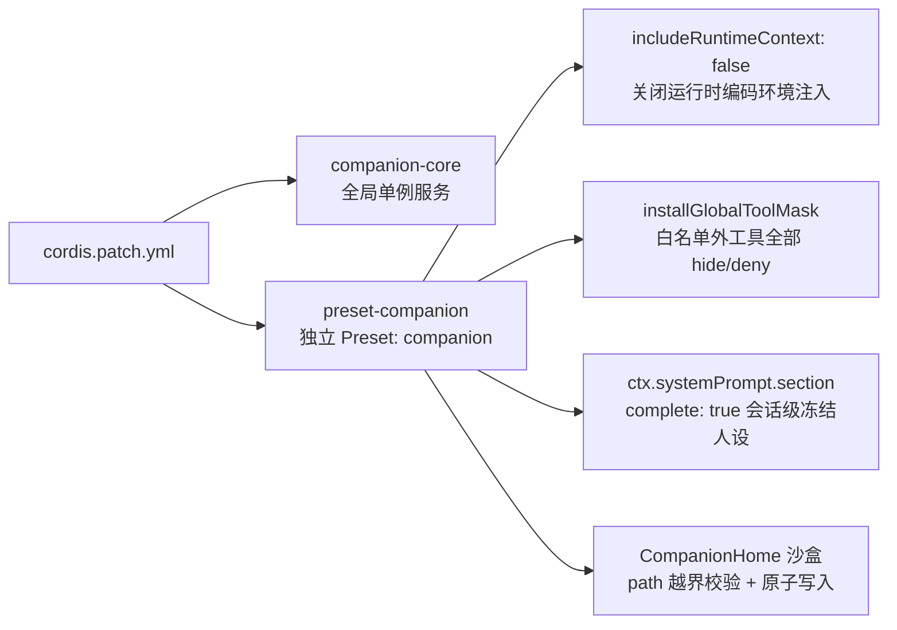
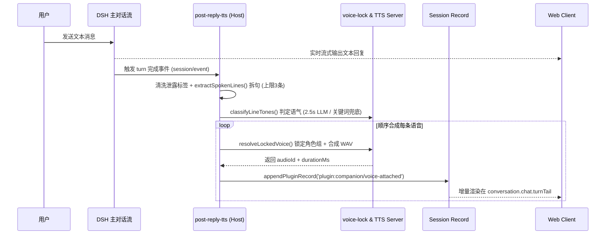

> [!IMPORTANT]
> 本文仅记录通用的插件工程架构、DSH 扩展机制、调度算法与排障经验。文中所涉角色名称、目录路径、音色 ID、会话 UUID 等均已脱敏为通用占位符（如 `<CompanionName>`、`<CompanionHome>`、`<VOICE_ID_DEFAULT>`）。

---

## 1. 背景与核心设计目标

DeepSeek Harness（以下简称 **DSH**）原生是一个面向编程、文件操作与工具调用的智能体宿主（Host + Web Client）。如果要将其改造成一个**高沉浸感、低延迟、具备长期记忆与主动关怀能力的 AI 伴侣系统**，不能只是简单写一段 System Prompt，否则会立刻遇到五个工程难题：

1. **工作区与身份串台**：代码仓库里的工具（文件读写、Shell、Git）与工作区提示词会破坏陪伴对话的沉浸感，且伴侣记忆不应绑死在某个代码目录下。
2. **上下文注入导致“底稿泄露”**：如果采用每轮动态注入 `<system-reminder>` 或可变 `runtimeContext`，随着轮次增加或记忆刷新，模型可能在回复中把底层人设、路径甚至音色列表原文复读出来。
3. **语音合成阻塞首字响应**：直接串行等 TTS 合成完再输出文字，会让聊天体验变得迟钝；同时需要支持多情绪音色组锁定（固定音色角色 + 按句切换情绪语气），而不能每句话依赖大模型显式调用工具。
4. **主动发消息机械且错位**：定时固定间隔弹窗极易打扰用户、造成未读轰炸；而主动消息写入聊天流时若锚点顺序处理不当，还会插入到上一轮回复文本与底部操作图标之间，导致 UI 错乱。
5. **前端语音交互体验**：需要微信风格的紧凑语音条、未读红点、仅首次点击连续自动连播以及与日常对话融为一体的时间线布局。

基于上述目标，我们设计并落地了独立插件 `@local/dsh-companion`，整体采用 **Core（纯 Node 无框架业务逻辑） / Host（Cordis 服务与事件桥接） / Client（Web UI 槽位注入）** 三层解耦架构：

```text
packages / @local/dsh-companion
├── package.json                 # 声明 dsh.bundle.patch 与 dsh.client 入口
├── cordis.patch.yml             # 挂载 companion-core 与隔离态 preset-companion
└── src/
    ├── core/                    # 纯 Node 业务逻辑（可脱离 DSH 独立单测）
    │   ├── companion-store.js   # CompanionHome 沙盒 Markdown 记忆仓库
    │   ├── voice-lock.js        # 角色多情绪音色组锁定 & 关键词兜底
    │   ├── reply-tts-helpers.js # 回复清洗（剥离 system-reminder）、分句、标签解析
    │   ├── tts-client.js        # 本地/兼容 TTS HTTP 客户端
    │   ├── wav-utils.js         # WAV 头解析与时长计算
    │   ├── audio-store.js       # 音频缓存与 HTTP Range 断点续传响应
    │   └── proactive-engine.js  # 拟人主动消息调度引擎与时间窗退避状态机
    ├── host/                    # DSH Cordis 插件层
    │   ├── index.js             # 注册 companion 服务与 /api/companion.* 路由
    │   ├── preset-scope.js      # 会话级冻结 System Prompt、工具屏蔽与 5 个记忆工具
    │   ├── post-reply-tts.js    # 监听 turn 结束事件 -> 异步分句合成语音气泡
    │   └── proactive.js         # 后台调度循环、主动文本+语音生成与回溯锚定
    └── client/                  # DSH Web 前端扩展
        └── client.js            # 微信风语音条、主动消息独立节点、右下角浮窗与连播控制
```

---

## 2. 四重隔离架构：把“编码工具链”彻底关在伴侣空间之外

为了让伴侣会话既能独立沉淀长期记忆，又绝不会意外执行代码工具或泄露编码上下文，系统在配置与运行时做了四层隔离：



### 2.1 `cordis.patch.yml` 隔离式 Preset 编排

在 `cordis.patch.yml` 中，通过专门的 `preset-companion` 挂载 `@local/dsh-companion/preset-scope`：

- `id: companion`：在 DSH UI 中成为独立 Preset；
- `includeRuntimeContext: false`：关闭 DSH 默认的运行时环境摘要注入；
- 显式声明仅挂载轻量基础组件（如 `dsh-tool-web`、`compaction-basic`、`command-compact`），**移除了原生 `@deepseek-ai/dsh-persona` 与重型代码工具包**，避免两者互相注入冲突提示词。

### 2.2 工具全局白名单屏蔽 (`installGlobalToolMask`)

在 `src/host/preset-scope.js` 中，除了关闭不需要的默认上下文外，还通过工具过滤钩子显式屏蔽非伴侣工具：当处于 `companion` Preset 作用域时，仅放行 5 个专属伴侣记忆/提醒工具及必要的搜索工具，其余文件系统、终端命令、代码编辑工具一律不可见。

### 2.3 CompanionHome 独立便携记忆仓库 (`src/core/companion-store.js`)

伴侣的灵魂设定与记忆全部以可读、可迁移、版本友好的 **Markdown + JSON Manifest** 形式保存在独立目录 `<CompanionHome>` 中，与任意开发工作区解耦：

- `companion.manifest.json`：角色名、音色锁定配置、主动消息参数、TTS 服务配置；
- `SOUL.md` / `IDENTITY.md`：核心性格、说话节奏与身份设定；
- `USER_PROFILE.md` / `MEMORY.md`：用户画像与长期核心记忆；
- `REMINDERS.md`：用户约定或待提醒事项；
- `memory/daily/` 与 `memory/events/`：按日日记与重要纪念事件；
- `voice-assets/`：与该角色绑定的参考音频资产占位说明。

工程安全细节：
- **路径沙盒校验 (`resolveSafePath`)**：所有读写先做 `path.resolve` 与相对前缀校验，拒绝 `..` 路径穿越；
- **原子写入**：先写临时 `.tmp` 文件再 `rename` 覆盖，防止并发写入或断电损坏档案；
- **自动脚手架初始化**：首次启动若目录为空，自动生成模板骨架，保证开箱即用。

### 2.4 五个伴侣专属工具

模型只通过以下 5 个语义化工具维护长期记忆与日程，无需接触底层路径：

| 工具名 | 用途 | 落盘位置 |
| :--- | :--- | :--- |
| `memory_log_daily` | 记录当天相处片段与情绪日记 | `memory/daily/YYYY-MM-DD.md` |
| `memory_record_event` | 记录里程碑或特殊纪念事件 | `memory/events/*.md` |
| `memory_update_core` | 沉淀需要长期记住的偏好或事实 | `USER_PROFILE.md` / `MEMORY.md` |
| `memory_recall` | 按关键词检索历史日记与记忆文件 | 只读检索 |
| `companion_reminders` | 新增、勾选或查询待办提醒 | `REMINDERS.md` |

---

## 3. 文本优先、语音后附：多情绪音色锁定管线

参考微信发语音的真实习惯——用户发送消息后希望**立刻看到回复文字**，紧接着短句逐条变成可点击播放的语音条，而不是苦等整个对话合成完毕才弹出内容。



### 3.1 角色音色锁定 (`src/core/voice-lock.js`)

为了防止模型或外部状态漂移到陌生音色，`resolveLockedVoice` 支持两种强制锁定模式：

- **`mode: 'character'`（多情绪音色组锁定）**：角色绑定一个受控 `allowedVoices` 列表（例如：`gentle_playful` 默认主声线、`deep_whisper`、`tsundere_tease`、`coquettish_complaint`、`serious_remind` 等多种情绪参考音）。每句话只能在该角色的合规子音色中切换，并保留 `TONE_KEYWORD_HINTS` 规则兜底；
- **`mode: 'strict'`（严格单音色锁定）**：无论上下文如何，强制映射回单一 `lockedVoiceId`。

### 3.2 非阻塞分句与超时降级 (`src/host/post-reply-tts.js`)

1. **回复文本清洗 (`src/core/reply-tts-helpers.js`)**：在拆分语音句之前，先正则剔除任何意外残留的 `<system-reminder>...</system-reminder>`、Markdown 冗余格式及非口语符号；
2. **上限控制**：每轮最多截取 3 段最有代表性的口语短句合成语音，避免长回复触发十余条语音条刷屏；
3. **快超时兜底 (`classifyLineTones`)**：优先请求轻量 LLM 对每句话标注情绪标签（单次超时 `2500ms`，外层 `Promise.race` 兜底 `2800ms`）；一旦超时或异常，无缝降级为本地正则与标点关键词启发式判定，绝不卡死后处理队列；
4. **顺序合成与断点续传 (`src/core/audio-store.js`)**：通过 `GET /api/companion.audio` 提供带 `Accept-Ranges` 与 HTTP `206 Partial Content` 支持的 WAV 流服务，保证浏览器 `<audio>` 拖放或重播稳定。

---

## 4. 拟人化“恋人节奏”主动消息引擎

机械的“每隔 N 分钟弹一条消息”很快会让人产生机器人感。在 `src/core/proactive-engine.js` 中，我们把主动发消息建模为一个**受作息约束、带有冷却时间与未读退避的随机状态机**。

### 4.1 默认调度参数与拟人机制 (`DEFAULT_PROACTIVE_CONFIG`)

| 参数 | 默认值 | 设计意图 |
| :--- | :--- | :--- |
| `quietHours` | `01:00` – `07:30` | 深夜睡眠静音时段，绝不主动打扰（除非紧急手动触发） |
| `minGapAfterReplyMinutes` | `25` 分钟 | **刚聊完不立刻打断**：距用户或 AI 上一次回复不足 25 分钟时不主动发起 |
| `minCooldownMinutes` | `45` 分钟 | 两次主动触发之间的硬冷却下限 |
| `daytimeIntervalMinutes` | `[55, 115]` 分钟 | 白天随机间隔，模拟忙里偷闲想起对方的真实节奏 |
| `eveningIntervalMinutes` | `[35, 75]` 分钟 | 晚间放松时段频率略高，贴近陪伴聊天习惯 |
| `morningWindow` / `nightWindow` | `08:00–11:30` / `22:30–23:55` | 每日一次早安问候与睡前晚安关心窗口 |
| `unansweredBackoffMinutes` | `[100, 170]` 分钟 | 若上一条主动消息仍未读/未回复，自动拉长间隔并礼貌克制 |
| `maxConsecutiveUnanswered` | `2` 条 | 连续 2 条主动消息未获回应即暂停后续主动打扰，等用户回来再重置 |
| `maxDailyMessages` | `6` 条/天 | 每日主动消息总预算上限，保留期待感 |
| `reminderLeadMinutes` | `15` 分钟 | 对 `REMINDERS.md` 中的约定事项提前 15 分钟温柔提醒 |

### 4.2 主动消息类型与提醒解析 (`findDueReminders`)

`REMINDERS.md` 支持自然书写常见时间格式（`YYYY-MM-DD HH:MM`、`YYYY-MM-DD`、`截止 HH:MM`）。调度器每轮评估时按优先级判定事件类型：

1. **到期提醒 (`reminder`)**：临近预约时间主动督促；
2. **早安 / 晚安窗口 (`morning` / `night`)**：每天各触发一次；
3. **日常思念与关心 (`checkin`)**：在白天或晚间随机间隔落入时结合最近对话话题生成自然问候（例如“刚忙完一会儿，突然想起你”），并同步合成一条短语音。

### 4.3 后台离线触发与 Turn 回溯锚定 (`resolveTurnForTimestamp` & `flushUnanchored`)

主动消息触发时，用户可能**正切在别的页面、或者当前尚未发送新一轮对话**。如果只把数据留在内存里，刷新后主动消息就会丢失或顺序错位；如果简单写死为 `lastTurn`，在用户恰好正在发送下一条消息时就会插错回合。

为此我们设计了**时间戳二分/线性回合锚定 (`resolveTurnForTimestamp`) + 延迟回填 (`flushUnanchored`)**：

1. 主动消息生成时记录精确毫秒时间戳 `createdAt`；
2. 若当前已能定位到归属会话 `targetSessionId`，在会话事件快照上查找 `turn/start` 边界，确定该条主动消息严格发生在哪一个已结束的 `turn` 之后；
3. 若当时会话尚未加载或处于离线态，先将其暂存为 `unanchored` 状态；一旦前端通过 `GET /api/companion.proactive` 轮询或用户切回会话，服务端调用 `proactiveController.flushUnanchored()` 补写 `plugin:companion/proactive-attached` 持久化记录到 `.dsh` 会话日志中，实现跨刷新不丢失。

---

## 5. 前端 UI 与 DSH 槽位渲染实战踩坑

在 Web 端扩展（`src/client/client.js`）上，通过 DSH 插件的 `slots` 与 `conversation/chat` API 注入视觉组件。这一块最容易出现**插槽层级错误**导致的布局错乱。

### 5.1 微信风语音条规范与连播逻辑 (`CompanionAudioManager`)

- **视觉极简**：气泡 `border-radius: 6px`，左侧小三角（`::before`），内部仅显示声波图标与秒数（如 `7"`），宽度随音频时长在合理区间自适应；
- **未读红点定位**：红点位于语音条**右上角**（绝对定位在气泡外缘右上），而非孤立排在语音条末尾占位；
- **去掉冗余进度条**：播放态直接通过声波动画与轻量高亮体现，移除气泡下方多余的进度条控件；
- **智能连播规则**：
  - 将已听过的 `audioId` 持久化至 `localStorage`；
  - **首次点击某条未读语音条**：播放结束后自动消除该条红点，并按页面顺序自动连播同一轮或连续的**下一条未读语音**；
  - **再次点击已读语音条**：仅单条重播，不再连带触发整串自动播放，符合直觉预期。

### 5.2 关键修复：被动语音 vs 主动消息的槽位分离

最初版本把主动消息和被动语音都塞进了 `conversation.chat.turnTail`，结果出现了两个严重视觉 Bug：
1. **被夹在正文和工具栏中间**：DSH 会在 turn 结束的 `turnTail` 下方渲染复制/点赞/分叉/Token 统计等 `MessageIconActions`，主动回复如果落在上一轮的 `turnTail`，就会看起来像硬塞在上一轮回复正文和它的底部小图标中间；
2. **带有重边框的内嵌卡片**：在对话流里显得生硬突兀，且用户刚好又发新消息时容易视觉顺序错乱。

**最终解决方案**：

```text
Turn N (被动对话回合)
  ├── 用户消息气泡
  ├── AI 回复正文
  ├── [conversation.chat.turnTail]  ---> 被动回复对应的微信风语音条 (companion-voice)
  └── DSH 原生 MessageIconActions     ---> 复制 / 点赞 / 用量 / 时间戳

[conversation.chat.node]              ---> 独立主动消息节点 (kind: 'companion-proactive')
  ├── anchorSeq = Math.max(state.seq, turnEndSeq ? turnEndSeq + 0.2 : state.seq)
  ├── 紧跟在 Turn N 的 MessageIconActions 之后、Turn N+1 之前！
  ├── 扁平左侧竖线视觉区分（无厚重卡片边框）+ 绿色在线圆点 + 时间 + 正文 + 语音条
  └── 点击交互后 via POST /api/companion.proactive.ack 消除右下角浮窗与未读提示
```

核心两点：
- **槽位解耦**：被动语音留在 `conversation.chat.turnTail`；主动消息改用独立的 `conversation.chat.node`（`target: 'chat'`, `groupTree: 'turn'`），并且 `anchorSeq` 显式落在 `turnEndSeq + 0.2` 之后，确保它永远渲染在上一轮**完整消息块（含底部操作图标）之后**；
- **双通道触达**：正在看主对话面板时，主动消息以轻量扁平块直接出现在对话流末尾；停留在其他标签页或工作区时，`shell.overlay` 右下角浮窗弹出轻量提醒，点击即可跳转或已读确认。

---

## 6. 线上疑难故障复盘与排障清单

在真实联调与实机测试中，以下两个底层问题最隐蔽，值得重点留档。

### 6.1 故障一：对话突然整段吐出 `<system-reminder>` 与 `SOUL.md` 原文

**现象**：长对话进行到某一轮时，伴侣回复正常聊了两句，紧接着突然把 `<system-reminder>`、`[CompanionHome 独立灵魂与记忆档案]`、全套音色 ID 列表以及 `SOUL.md` 设定原文原封不动输出在对话气泡中。

**根因分析**：
1. 早期实现把伴侣档案与音色约束通过 `ctx.systemPrompt.context(...)` 动态注入；在 DSH 内部，可变 context 会被包装为 `<system-reminder>` 消息块并在轮次演进或变更时重复注入到对话中；
2. 同时挂载了默认 `@deepseek-ai/dsh-persona` 且未关闭 `runtimeContext`，双重系统提醒让模型误以为当前对话正在要求它“输出或回顾上下文档案”；
3. 模型一旦把 `<system-reminder>` 输出到正文，不仅破功，下一轮语音拆分器还会把底层设定读出来送去 TTS 合成。

**根治方案**：
1. 在 `src/host/preset-scope.js` 中**改用会话级一次性冻结的 `ctx.systemPrompt.section`（设置 `complete: true`）**，并在该作用域注册 `suppressRuntimeContext()`，同时在 `cordis.patch.yml` 中配置 `includeRuntimeContext: false`，彻底消灭每轮动态 `<system-reminder>` 注入；
2. 音色约束改为纯后台逻辑描述，不在提示词中暴露内部绝对路径、内部 ID 等易诱发模型复读的技术字段；
3. 在 `src/core/reply-tts-helpers.js` 的 `extractSpokenLines()` 增加防御性过滤，合成语音前先剥离任何 `<system-reminder>...</system-reminder>` 块。

### 6.2 故障二：从旧测试会话清除误泄露轮次，为什么直接重压 Zstd 会导致会话消失？

**现象**：为了保留之前已经聊出默契的长对话，我们尝试从对应的 `.dsh/sessions/<session-id>/session.v4.jsonl.zstd` 中剔除那条意外泄露底层设定的异常轮次。如果用普通命令把清理后的 JSONL 重新单帧压缩写回，DSH 启动后左侧列表甚至 workspace 分组会找不到该会话或读取失败。

**关键发现（DSH 会话存储不变量）**：
1. **Zstd 多帧独立格式**：DSH 的 `session.v4.jsonl.zstd` 并不是单个 Zstd 流，而是**每 1 条（或每批追加）独立 JSONL 记录对应一个带校验和的独立 Zstd Frame**（`ZSTD_c_checksumFlag: 1`），用于高效追加写而不必全量解压重写；
2. **`seq` 严格连续单调不间断**：内部每条 JSONL 记录带有 `seq` 序号，删除末尾或中间几条记录时，剩余记录的 `seq` 必须保持 `0 .. N` 严格连续；
3. **Workspace 映射索引**：会话属于哪个工作区（例如 CompanionHome 与“未分组”），由宿主配置目录 `~/.dsh/storages/workspace.json` 维护，清理会话文件前后需先关闭 DSH 进程再同步校验索引映射，且操作前务必留存 `.v4.jsonl.zstd` 备份。

---

## 7. 构建、验证与发布工作流

### 7.1 脱离浏览器的快速单元测试策略

实际排查表明，在受限环境跑重型无头浏览器 CDP 端到端测试很容易因超时卡死；将全部核心逻辑下沉到 `src/core/` 后，用 Node 原生测试框架即可在 1 秒内完成全量回归：

```bash
# 1. 语法静态检查（覆盖 src/core, src/host, src/client 等全部 JS 模块）
node --check src/core/*.js src/host/*.js src/client/*.js

# 2. 运行核心单测（涵盖音色锁定、标签剥离、主动调度退避、时间戳锚定与前端脚本结构断言）
node --test tests/bundle-and-client.test.mjs tests/post-reply-tts.test.mjs
```

核心单测（19 项用例）重点守住以下不变量：
- `resolveLockedVoice` 在 `character` 与 `strict` 模式下的边界行为；
- `extractSpokenLines` 必须剥离 `<system-reminder>` 与技术噪声，且分句不超过上限；
- `ProactiveEngine` 在夜间静音、`minGapAfterReplyMinutes` 未满足、连续未读达到 `maxConsecutiveUnanswered` 时的拦截逻辑；
- `resolveTurnForTimestamp` 在多轮边界与未锚定补写场景下的准确性；
- 客户端代码中 `companion-voice` 与 `companion-proactive` 槽位互不串台、`anchorSeq` 在 `turnEndSeq` 之后。

### 7.2 插件打包与 Profile 部署

在 DSH 目录中启用独立 Profile 或通过 bundle patch 挂载 `@local/dsh-companion` 时：

1. 先执行 `node --check` 与 `node --test` 确保全部测试通过（零失败、零跳过）；
2. 将更新后的插件包同步到 DSH 本地 bundle 目录并重建 bundle（或重启 DSH 服务进程触发 Cordis 重新加载）；
3. 确认 `<CompanionHome>/companion.manifest.json` 中的 `voice` 与 `proactive` 参数已生效，打开对应 Preset（`companion`）即可无感热切换。

---

## 8. 总结

将一个通用 Agent 框架改造成“像真实恋人一样自然发微信与发语音”的 AI 伴侣，难点从来不在写几百字 Prompt，而在于**系统工程的克制与边界划分**：

- **提示词与上下文层要克制**：用会话级冻结 Section 替代高频动态注入，杜绝长对话“精神分裂”或吐出系统底稿；
- **语音链路要异步分句**：文本秒回 + 后端逐句锁音色合成，既保留文字聊天的流畅度，又赋予语音情绪温度；
- **主动触达要像真人的作息**：睡眠勿扰、刚聊完冷却、未读退避、每天封顶，用克制换取信任感；
- **UI 与状态必须因果闭环**：让被动语音留在本回合尾部，让主动问候独立落在上一轮操作图标之后，确保时间线永远干净有序。
