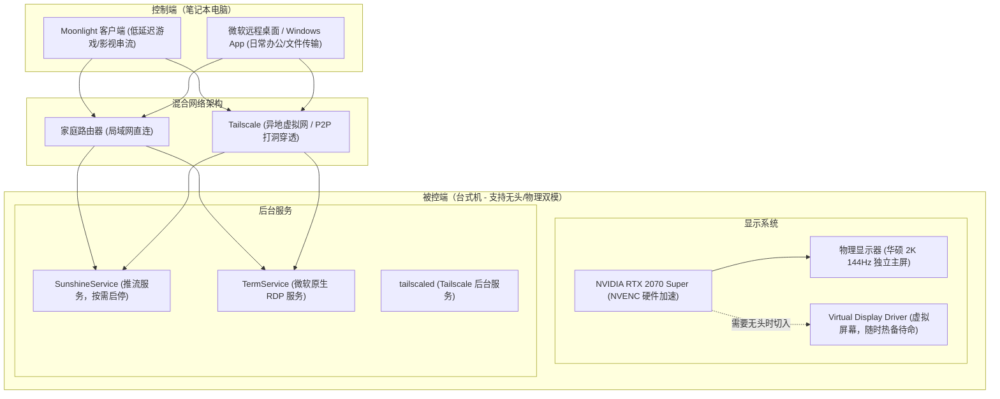

> **文档版本**：v2.0（包含无头搭建、外网穿透与物理显示器恢复全生命周期记录）  
> **更新日期**：2026-09-21  
> **适用硬件**：华硕主板平台（PRIME Z390-A）、Intel 网卡（I219-V）、NVIDIA 独立显卡（RTX 2070 Super）、32GB 内存、华硕 27寸 2K 144Hz/165Hz 电竞显示器  
> **适用场景**：
> 1. 显示器损坏/无物理屏幕期间，由笔记本通过局域网/外网进行全天候 2K 超清低延迟串流（Moonlight/Sunshine）与远程办公（RDP/Windows App）。
> 2. 物理显示器修好后，平滑恢复原生 2K 144Hz 独立主屏，同时保留虚拟驱动随时热备切回。

## 目录
- [一、 方案架构总览](#一-方案架构总览)
- [二、 Windows 10 家庭版无损升级专业版与永久激活（MAS 神器）](#二-windows-10-家庭版无损升级专业版与永久激活mas-神器)
  - [2.1 为什么需要升级专业版？](#21-为什么需要升级专业版)
  - [2.2 MAS 开源升级与永久激活实战](#22-mas-开源升级与永久激活实战)
  - [2.3 扩展升级：3年商业补丁 (ESU) 与 Office 全套激活](#23-扩展升级3年商业补丁-esu-与-office-全套激活)
- [三、 解决无头黑屏：虚拟显示器驱动（Virtual Display Driver）部署](#三-解决无头黑屏虚拟显示器驱动virtual-display-driver部署)
  - [3.1 核心痛点与解决原理](#31-核心痛点与解决原理)
  - [3.2 驱动部署与安装步骤](#32-驱动部署与安装步骤)
  - [3.3 配置文件与分辨率定义](#33-配置文件与分辨率定义)
- [四、 开机未登录全天候连接：Sunshine 与 RDP 协同配置](#四-开机未登录全天候连接sunshine-与-rdp-协同配置)
  - [4.1 Sunshine 服务端选型与服务化常驻](#41-sunshine-服务端选型与服务化常驻)
  - [4.2 笔记本 Moonlight 配对与未登录直连](#42-笔记本-moonlight-配对与未登录直连)
  - [4.3 微软原生远程桌面（Windows App / RDP）2K 缩放配置](#43-微软原生远程桌面windows-app--rdp2k-缩放配置)
  - [4.4 跨地域外网穿透：Tailscale 虚拟大局域网与 P2P 直连机制](#44-跨地域外网穿透tailscale-虚拟大局域网与-p2p-直连机制)
- [五、 网络唤醒（WOL）排查与华硕主板关机重启 Bug 避坑全纪实](#五-网络唤醒wol排查与华硕主板关机重启-bug-避坑全纪实)
  - [5.1 华硕 Z390 关机自动重启的排查与根因](#51-华硕-z390-关机自动重启的排查与根因)
  - [5.2 休眠（Hibernate）与 32GB 内存磁盘空间揭秘](#52-休眠hibernate与-32gb-内存磁盘空间揭秘)
  - [5.3 最佳开机实践与备用方案](#53-最佳开机实践与备用方案)
- [六、 物理显示器修好恢复与设置回退实录（平滑热备模式）](#六-物理显示器修好恢复与设置回退实录平滑热备模式)
  - [6.1 为什么保留虚拟显示器驱动而非卸载？](#61-为什么保留虚拟显示器驱动而非卸载)
  - [6.2 手动切回物理主屏操作（Windows 显示设置）](#62-手动切回物理主屏操作windows-显示设置)
  - [6.3 缩放与布局历史记录考证（125% 黄金比例）](#63-缩放与布局历史记录考证125-黄金比例)
  - [6.4 物理显示器 144Hz 与 165Hz 深度技术对比（四大弊端揭秘）](#64-物理显示器-144hz-与-165hz-深度技术对比四大弊端揭秘)
  - [6.5 停用 Sunshine 开机自启（释放 GPU 与内存资源）](#65-停用-sunshine-开机自启释放-gpu-与内存资源)
  - [6.6 以后需要再次远程时的一秒热唤醒操作](#66-以后需要再次远程时的一秒热唤醒操作)
- [七、 常用运维命令与速查表](#七-常用运维命令与速查表)

---

## 一、 方案架构总览



---

## 二、 Windows 10 家庭版无损升级专业版与永久激活（MAS 神器）

### 2.1 为什么需要升级专业版？
1. **解除微软远程桌面限制**：Windows 家庭版原生阉割了 `TermService` 被控端功能，无法作为远程桌面的接收端。
2. **解锁组策略与高级安全控制**：专业版具备组策略（`gpedit.msc`）、BitLocker、高级电源管理以及服务权限管理能力。

### 2.2 MAS 开源升级与永久激活实战
本项目借助全球最知名的微软开源激活脚本库 **Microsoft-Activation-Scripts (MAS)**（GitHub 顶级开源项目，官方域名：`massgrave.dev`）。

> [!NOTE]
> **无损升级原理**：Windows 10 各个版本的系统二进制文件完全相同，家庭版只是通过注册表和授权策略禁用了高级组件。MAS 借助微软官方的“版本切换通用密钥”（Edition Switch Key），数秒内即可原地激活并解锁专业版所有功能，**无需重装系统，不丢失任何个人文件与应用**。

#### 操作步骤：
1. 以管理员身份启动 **PowerShell**，运行官方在线一键命令：
   ```powershell
   irm https://get.activated.win | iex
   ```
   *(亦可从 GitHub 下载离线版 `MAS_AIO.cmd` 右键以管理员身份运行)*。

2. **版本原地升级**：
   - 在弹出的 MAS 字符菜单中，输入 `[6] Extras` 进入扩展菜单；
   - 输入 `[1] Change Windows Edition`；
   - 选择 `Professional`（专业版）；
   - 脚本会自动向系统注入微软通用升级密钥 `VK7JG-NPHTM-C97JM-9MPGT-3V66T`，Windows 会在后台静默安装专业版组件，数秒即可完成升级。

3. **数字权利永久激活 (HWID)**：
   - 返回 MAS 主菜单，输入 `[1] HWID`；
   - 脚本通过收集主板硬件特征码并直接与微软官方激活服务器通讯，下发**永久数字许可证（Retail 零售渠道授权）**；
   - **效果**：激活状态绑定主板芯片组，即使未来格式化 C 盘重装系统，只要联网就会自动识别为主板正版并永久激活。

### 2.3 扩展升级：3年商业补丁 (ESU) 与 Office 全套激活
- **Windows 10 扩展安全更新 (TSforge ESU)**：
  - Windows 10 官方将于 2025 年 10 月停止主流支持。通过 MAS 中的 TSforge 模块，已为系统注入企业商业版 ESU（Year 1～3）授权，使台式机在 2025～2028 年间继续稳定接收微软官方的安全补丁与系统更新。
- **Office Mondo 2016 / 365 全套组件激活**：
  - 采用 **Ohook** 注入机制（核心钩子 `sppc.dll`）。
  - 支持 Word、Excel、PowerPoint、Visio 专业版、Project 专业版全套功能，终身永久授权，不依赖任何第三方 KMS 进程常驻，支持 Office 在线更新。

---

## 三、 解决无头黑屏：虚拟显示器驱动（Virtual Display Driver）部署

### 3.1 核心痛点与解决原理
- **物理现象**：当台式机拔掉所有 HDMI / DisplayPort 实体显示器线缆后，NVIDIA 独立显卡因未检测到物理阻抗信号，会自动将图形输出休眠，或者将屏幕分辨率锁死在 `640x480`。
- **后果**：Sunshine 抓屏服务会抛出 `Cannot find display` 错误，或 Moonlight 连入后呈现一片漆黑。
- **解决方案**：安装基于微软官方 IddCx（间接显示驱动架构）的开源软件驱动 **Virtual Display Driver (VDD)**。它会在系统内部虚拟出一台支持任意分辨率（1080p、2K、4K）和高刷新率（60Hz、120Hz、144Hz）的高性能显示设备。

### 3.2 驱动部署与安装步骤
1. **固定安装目录**：  
   建议将驱动放置在固定系统路径，例如：`C:\VirtualDisplayDriver\`（安装后切勿删除或重命名此文件夹）。
2. **导入签名证书**：  
   - 双击 `Virtual_Display_Driver.cer`；
   - 选择【安装证书】 $\to$ 存储位置选择【本地计算机】；
   - 将证书放入：**“受信任的根证书颁发机构”**。
3. **注册安装驱动**：  
   - 以管理员身份运行 `install.bat`（或执行 `nefconc.exe --install MttVDD.inf`）；
   - 设备管理器中的“显示适配器”或“显示器”下将新增 `Virtual Display Driver`。

### 3.3 配置文件与分辨率定义 (`vdd_settings.xml`)
在驱动根目录下提供 `vdd_settings.xml` 配置文件，用于定义虚拟屏幕的默认分辨率与全局刷新率参数：
```xml
<?xml version='1.0' encoding='utf-8'?>
<vdd_settings>
    <monitors>
        <count>1</count>
    </monitors>
    <gpu>
        <friendlyname>default</friendlyname>
    </gpu>
	<global>
		<g_refresh_rate>60</g_refresh_rate>
		<g_refresh_rate>90</g_refresh_rate>
		<g_refresh_rate>120</g_refresh_rate>
		<g_refresh_rate>144</g_refresh_rate>
		<g_refresh_rate>165</g_refresh_rate>
	</global>
    <resolutions>
        <resolution>
            <width>1920</width>
            <height>1080</height>
            <refresh_rate>30</refresh_rate>
        </resolution>
        <resolution>
            <width>2560</width>
            <height>1440</height>
            <refresh_rate>30</refresh_rate>
        </resolution>
    </resolutions>
</vdd_settings>
```

---

## 四、 开机未登录全天候连接：Sunshine 与 RDP 协同配置

### 4.1 Sunshine 服务端选型与服务化常驻
- **推荐版本**：**Sunshine v0.23.1**（数万用户验证的最稳定版本，完全开源免费，无任何收费提示弹窗）。
- **关键安装设置**：
  - 运行安装包时，**务必勾选【Install as Windows Service】**。
  - 这会将 Sunshine 注册为 Windows 系统服务 `SunshineService`。
  - **优势**：它运行在 Windows 底层特权级（Session 0），即使电脑刚开机、还停留在 Windows 输入密码的锁屏界面，Sunshine 也会在后台全速抓屏推流。
- **关于虚拟手柄驱动的避坑**：
  - 安装界面提示的 `ViGEmBus` 或 `libvirtualhid` 均为游戏主机手柄模拟驱动；纯办公、写代码操作**完全不需要安装手柄驱动**，直接跳过即可。

### 4.2 笔记本 Moonlight 配对与未登录直连
1. **初次配对**：
   - 台式机浏览器打开管理面板：`https://localhost:47990`（首次创建管理员账密）；
   - 笔记本连接相同局域网（或通过 Tailscale），打开 **Moonlight** 客户端；
   - 点击右上角 **【➕】**，输入台式机 IP，弹出 4 位数字 PIN；
   - 在台式机 Sunshine Web 面板的 **PIN** 菜单输入该 4 位数并确认保存，双方自动交换加密证书完成绑定。
2. **证书冲突排查（Error 401 避坑）**：
   - 若出现 `The client is not authorized. Certificate verification failed. (Error 401)`：
   - 解决办法：在 Sunshine 网页后台 $\to$ **Troubleshooting** $\to$ 点击 **Unpair All**；在笔记本 Moonlight 中右键删除旧电脑，重新输入 PIN 配对即可解决。

### 4.3 微软原生远程桌面（Windows App / RDP）2K 缩放配置
对于使用微软新版 **Windows App**（或 Microsoft Remote Desktop）连接 1080p 笔记本时：
1. 右键台式机卡片 $\to$ 点击 **【编辑】（Edit）**；
2. 切换到 **【显示】（Display）** 选项卡；
3. **分辨率（Resolution）**：取消勾选“匹配此显示器”，下拉手动选择 **`2560 × 1440`**；
4. **画面自适应**：勾选 **【缩放以适合窗口】（Fit session to window）**，并关闭“调整大小时更新分辨率”；
5. **效果**：系统在后台以 2K 原生环境排版，桌面图标绝对不被挤乱，同时等比缩放适应笔记本屏幕。

### 4.4 跨地域外网穿透：Tailscale 虚拟大局域网与 P2P 直连机制
- **工作原理**：
  - 台式机与笔记本安装 **Tailscale**，登录相同账号，建立虚拟专属 Tailnet 网络；
  - 台式机获得永久固定静态 IP（如 `100.x.y.z`），无论是重启、换 Wi-Fi 还是搬家，该 IP 终身不变。
- **智能 P2P 直连（DISCO 协议）**：
  - 虽然软件里输入的是 `100.x.y.z` 虚拟 IP，但当两台电脑处于同一个家庭路由器下时，Tailscale 会自动探测并降维走**本地家庭千兆局域网传输（延迟 1~4ms，不走外网流量）**；
  - 当笔记本带到外地出差或连手机 5G 时，Tailscale 会全自动无感切换为**跨互联网 P2P 穿透打洞**，用户无需切换任何 IP 设置。
- **关键首选项设置（Preferences）**：
  - `Allow incoming connections`：必须勾选（允许外部连入）。
  - `Run unattended`：强烈建议勾选（无人值守后台服务，锁屏开机即自动联网）。
  - `Allow local network access`：保持勾选（允许访问本地打印机和路由器）。

---

## 五、 网络唤醒（WOL）排查与华硕主板关机重启 Bug 避坑全纪实

### 5.1 华硕 Z390 关机自动重启的排查与根因
- **故障现象**：  
  在华硕 BIOS APM 设置中将 `由 PCI-E 设备唤醒 (Power On By PCI-E)` 设为 `Enabled` 以支持网卡网络唤醒后，台式机在 Windows 中点击“关机”，主机断电熄灭约 30~40 秒后，**会自动重新通电开机**。
- **排除法实验**：  
  将台式机网线**彻底拔掉后关机**，主机依然在 30 秒后自动重启。由此直接排除了“路由器局域网广播包唤醒”的嫌疑。
- **硬件底层根本原因**：  
  这是 **华硕 Z390 系列主板（特别是 PRIME Z390-A）搭配 Intel I219-V 板载千兆网卡** 的经典硬件通病。当开启 PCI-E 唤醒监听时，主板会监视 PME# 引脚电平。但在 Windows 正常关机切断 12V 主电源进入 S5 状态的瞬间，网卡由于断电降速（从千兆协商至百兆待机模式）以及供电电平衰减，在总线上产生了一个微弱的**瞬态电压毛刺（Voltage Transient / Glitch）**。华硕主板 BIOS 对该毛刺极其敏感，误将其判定为网卡下发的开机脉冲，从而在几十秒后触发整机自动重启。

### 5.2 休眠（Hibernate）与 32GB 内存磁盘空间揭秘
- **关于为什么关闭休眠**：  
  在排查过程中确认，由于本机配备了 **32 GB 物理内存**，Windows 默认的完整休眠机制会将内存中所有数据整盘写入 C 盘根目录下的隐藏文件 `hiberfil.sys`。
  - **空间消耗**：32GB 内存对应的 `hiberfil.sys` 会强行吃掉 C 盘固态硬盘 **16 GB ～ 24 GB+** 的可用空间！
  - **优化对策**：在管理员命令行中执行 `powercfg -h off`，既能释放这二十多 G 的宝贵 SSD 空间，又能避免每次休眠往 SSD 固态闪存巨量写入造成的寿命损耗。建议永久保持关闭。

### 5.3 最佳开机实践与备用方案
经过综合权衡与实测验证，针对无头台式机，推荐以下最稳妥、最舒服的使用方案：

#### 方案 A：物理按键开机（当前落地方案）
- **操作**：华硕 BIOS 中将 `由 PCI-E 设备唤醒 (Power On By PCI-E)` 彻底设为 **`已禁用 (Disabled)`**。
- **效果**：彻底切除主板对关机瞬态毛刺的误唤醒，电脑在 Windows 中点关机后，安安静静断电断风扇，绝对不会半夜自动重启；随手按一下机箱正面的物理开机键，通电开机后秒连。

#### 方案 B：Wi-Fi 智能插座 + 主板“通电自启”（远程开机终极方案）
如果未来需要真正的人在室外、跨互联网随时给家里台式机远程开机：
1. 购买一个 20~30 元的 Wi-Fi 智能插座（如米家、涂鸦等）；
2. 华硕 BIOS $\to$ 高级 $\to$ 高级电源管理 $\to$ 将 **`断电恢复后电源状态 (Restore AC Power Loss)`** 设置为 **`电源开启 (Power On)`**；
3. BIOS 中保持 `由 PCI-E 设备唤醒: Disabled`（保证关机不重启）；
4. 电脑关机后通过手机 App 断开插座；想用时打开插座电源，主机通电即自动开机，100% 稳定可靠。

---

## 六、 物理显示器修好恢复与设置回退实录（平滑热备模式）

当实体显示器修好归来后，台式机需要从“无头远程主机”无缝回归为“独立高性能主力机”。以下为实际操作全流程记录：

### 6.1 为什么保留虚拟显示器驱动而非卸载？
- **原因**：虚拟显示器驱动在平时不处于活动状态时，不占用任何显卡渲染算力；
- **热备优势**：保留驱动文件，未来如果临时需要拔掉显示器出差或带笔记本在床上玩游戏，不需要重新部署安装，只需按快捷键 `Win + P` 即可一秒唤醒切入远程模式。

### 6.2 手动切回物理主屏操作（Windows 显示设置）
1. 将物理显示器视频线插入 **RTX 2070 Super 独立显卡** 接口（勿插主板）；
2. 桌面空白处右键 $\to$ **【显示设置】**；
3. 顶部选中代表物理显示器的方块 **【1】**；
4. 勾选 **【设为主显示器】（Make this my main display）**（桌面图标和主任务栏全部回归物理屏幕）；
5. 下拉菜单找到“多显示器设置”，由“扩展”切换为 **【仅在 1 上显示】（Show only on 1）** 并保留更改。
   - **效果**：系统完全休眠虚拟屏幕，仅有一块物理屏幕输出，鼠标绝不滑出屏幕外。

### 6.3 缩放与布局历史记录考证（125% 黄金比例）
- **考证结果**：通过调取注册表 `HKCU:\Control Panel\Desktop\PerMonitorSettings` 历史记录，该华硕 27寸 2K 显示器的历史键值为 `DpiValue = 1`；
- **标准参数**：在 Windows 中，`0` 代表 100%，`1` 代表 **125% 缩放**。
- **结论**：在 27 寸 2K 分辨率（2560×1440）下，**125% 缩放是最护眼、文字大小最适中、与修好前完全一致的黄金比例**。

### 6.4 物理显示器 144Hz 与 165Hz 深度技术对比（四大弊端揭秘）
在底层硬件探测中，该物理显示器原生支持 `144Hz` 与超频 `165Hz`。之所以推荐锁定在 **`144 Hz`**，原因如下：
1. **显存锁死高频与待机功耗（N卡高刷 Bug）**：
   - 在 144Hz 下，RTX 2070 Super 显存进入 P8 深度休眠，待机功耗仅约 **10W**，风扇停转冰凉；
   - 在 165Hz 下，N卡驱动常误判像素时钟过高，显存锁死在 7000MHz 满频，待机功耗暴增至 **35W~45W**，发热明显。
2. **过冲与逆残影（Inverse Ghosting）**：
   - 165Hz 需要面板极限加压 Overdrive，快速滚动网页时文字边缘容易产生刺眼的白色/暗色鬼影，长时间使用容易眼疲劳；144Hz OD 调校最完美，字体最扎实。
3. **色彩带宽受限**：
   - DP 1.2 接口下，165Hz 压榨满总线带宽，被迫锁死在 8-bit 色深；144Hz 下带宽充裕稳定。
4. **感知差异极小**：
   - 144Hz 到 165Hz 单帧时间仅缩短 0.88 毫秒，人眼基本无法察觉，但 144Hz 的稳定性与温控大幅领先。

### 6.5 停用 Sunshine 开机自启（释放 GPU 与内存资源）
既然作为独立电脑使用，无需 Sunshine 每秒在后台捕获屏幕：
1. 按 `Win + R` 输入 `services.msc` 打开服务列表；
2. 找到 **`Sunshine Service`**；
3. 右键属性 $\to$ 将启动类型由【自动】改为 **【手动】**，并点击【停止】服务。
*(亦可直接运行桌面脚本 `关闭Sunshine自启并停止.bat` 一键完成)*。

### 6.6 以后需要再次远程时的一秒热唤醒操作
未来若临时拔掉显示器出差，只需：
1. 启动 Sunshine 服务（或运行开始菜单 Sunshine）；
2. 键盘按下 **`Win + P`**，选择 **【扩展】**；
3. 虚拟屏幕瞬间复活，笔记本连入即刻恢复 2K 串流！

---

## 七、 常用运维命令与速查表

### 1. 电源与休眠管理（管理员 PowerShell）
```powershell
# 查询当前系统睡眠状态支持情况
powercfg /a

# 查询当前有权限唤醒电脑的设备列表（正常应为“无”）
powercfg /devicequery wake_armed

# 彻底关闭系统休眠，释放 C 盘 20GB+ 空间
powercfg -h off

# 确保台式机接通电源时不自动睡眠、不休眠（防失联）
powercfg /change standby-timeout-ac 0
powercfg /change hibernate-timeout-ac 0
```

### 2. 核心服务与驱动状态监控
```powershell
# 检查 Sunshine 服务运行状态
Get-Service SunshineService

# 检查当前活动显示器与分辨率
Get-CimInstance Win32_VideoController | Select-Object Name, CurrentHorizontalResolution, CurrentVerticalResolution, CurrentRefreshRate

# 检查网卡 IP 与 MAC 地址
Get-NetAdapter | Select-Object Name, InterfaceDescription, Status, MacAddress
```

### 3. 网络与防火墙关键端口速查
- **Sunshine 串流端口**：`47984-47990` (TCP/UDP), `48010` (UDP)
- **Sunshine Web 后台**：`47990` (HTTPS)
- **微软原生远程桌面 (RDP)**：`3389` (TCP/UDP)
- **局域网设备发现**：`5353` (mDNS UDP)
