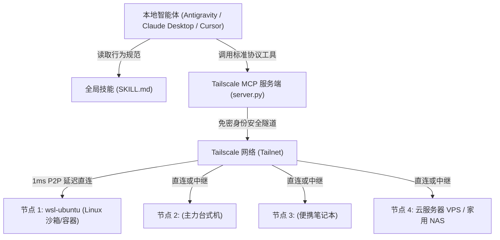

> **文档说明**：本文档记录了如何将当前建立的「Tailscale + 标准 MCP 服务端 + 智能体 Skill」多机协同体系完整复刻到任意其他电脑上。配置完成后，任何支持 MCP 协议的 AI 助手（如 Google Antigravity、Claude Desktop、Cursor 等）均可瞬间成为整个私有局域网的“中央调度中心”，自由接管与运维所有接入的设备。

## 一、系统架构与核心复用逻辑



### 为什么只需要迁移 MCP + Skill？
1. **网络层自动互通**：Tailscale 已经基于 WireGuard 在所有设备间打通了安全的虚拟局域网和免密认证；
2. **MCP 是标准协议**：`server.py` 是完全标准的 FastMCP 服务端，把“查网络拓扑、远程敲 SSH 命令、测延迟”封装为了任何 AI 都能调用的 3 个标准函数；
3. **Skill 是通用大脑**：`SKILL.md` 告诉 AI 助手你的网络里有哪些设备、该如何安全地调度它们。

---

## 二、新设备极简前置条件

在新电脑（无论是 Windows、macOS 还是 Linux）上，只需满足以下 3 点：

1. **已安装并登录同一个 Tailscale 账号**（确保该机器已加入你的 Tailnet 网络）；
2. **已安装 Python（推荐 3.10+）**，并在终端执行安装 FastMCP 依赖：
   ```bash
   pip install fastmcp
   ```
3. **已安装目标 AI 客户端**（如 Google Antigravity、Claude Desktop、Cursor 等）。

---

## 三、新设备完整配置步骤（三步搞定）

### 第一步：放置通用 MCP 服务端脚本 (`server.py`)

在新电脑上创建目录并保存以下脚本：
* **Windows 推荐路径**：`C:\Users\<用户名>\.gemini\config\mcp\tailscale_bridge\server.py`
* **macOS / Linux 路径**：`~/.gemini/config/mcp/tailscale_bridge/server.py`

#### 脚本源码 (`server.py`)
```python
import os
import sys
import json
import shutil
import subprocess

# 彻底禁用联网检查更新与横幅输出，确保 stdio 协议纯净
os.environ["FASTMCP_CHECK_FOR_UPDATES"] = "off"

if hasattr(sys.stdout, 'reconfigure'):
    sys.stdout.reconfigure(encoding='utf-8', errors='replace')
if hasattr(sys.stderr, 'reconfigure'):
    sys.stderr.reconfigure(encoding='utf-8', errors='replace')

from fastmcp import FastMCP

mcp = FastMCP("tailscale-bridge")

def get_tailscale_bin() -> str:
    default_p = r"C:\Program Files\Tailscale\tailscale.exe"
    if os.path.exists(default_p):
        return default_p
    which_p = shutil.which("tailscale")
    return which_p or "tailscale"

@mcp.tool()
def tailscale_list_devices() -> str:
    """List all devices in the Tailscale network, their hostnames, IPs, OS, and status."""
    bin_path = get_tailscale_bin()
    try:
        res = subprocess.run([bin_path, "status", "--json"], capture_output=True, text=True)
        if res.returncode != 0:
            return f"Error running tailscale status: {res.stderr}"
        data = json.loads(res.stdout)
        peers = data.get("Peer", {})
        self_node = data.get("Self", {})
        
        devices = []
        self_ips = ", ".join(self_node.get("TailscaleIPs", []))
        devices.append({
            "name": self_node.get("HostName", "self"),
            "ip": self_ips,
            "os": self_node.get("OS", ""),
            "online": self_node.get("Online", True),
            "is_self": True
        })
        
        for p in peers.values():
            ips = ", ".join(p.get("TailscaleIPs", []))
            devices.append({
                "name": p.get("HostName", ""),
                "ip": ips,
                "os": p.get("OS", ""),
                "online": p.get("Online", False),
                "is_self": False
            })
            
        lines = [
            "| Node Name | Tailscale IP | OS | Online | Role |",
            "| :--- | :--- | :--- | :--- | :--- |"
        ]
        for d in devices:
            role = "Self (Host)" if d["is_self"] else "Peer"
            status = "Online" if d["online"] else "Offline"
            lines.append(f"| {d['name']} | {d['ip']} | {d['os']} | {status} | {role} |")
            
        return "\n".join(lines)
    except Exception as e:
        return f"Exception querying devices: {str(e)}"

@mcp.tool()
def tailscale_ssh_run(target_node: str, command: str, username: str = "") -> str:
    """Execute a command remotely on a Tailscale node via Tailscale SSH.
    
    Args:
        target_node: The hostname or Tailscale IP of the target device (e.g. 'wsl-ubuntu', '<LAPTOP_HOST>').
        command: The command line string to execute remotely.
        username: Optional username to log in as (e.g. 'fortress', 'root').
    """
    bin_path = get_tailscale_bin()
    target = f"{username}@{target_node}" if username else target_node
    try:
        cmd = [bin_path, "ssh", target, command]
        res = subprocess.run(cmd, capture_output=True, text=True, timeout=60)
        out = res.stdout
        err = res.stderr
        code = res.returncode
        return f"Exit code: {code}\nStdout:\n{out}\nStderr:\n{err}"
    except subprocess.TimeoutExpired:
        return f"Command timed out after 60s while running on {target_node}: {command}"
    except Exception as e:
        return f"Execution error: {str(e)}"

@mcp.tool()
def tailscale_ping_device(target_node: str) -> str:
    """Test connectivity and latency to a Tailscale node."""
    bin_path = get_tailscale_bin()
    try:
        res = subprocess.run([bin_path, "ping", "-c", "3", target_node], capture_output=True, text=True, timeout=15)
        return res.stdout or res.stderr
    except Exception as e:
        return f"Ping failed: {str(e)}"

if __name__ == "__main__":
    mcp.run(show_banner=False)

```

---

### 第二步：在智能体配置文件中注册 MCP 服务端

#### 1. 如果新电脑使用的是 **Google Antigravity**：
打开配置目录下的 `~/.gemini/config/mcp_config.json`，在 `mcpServers` 对象中追加配置：
```json
{
  "mcpServers": {
    "tailscale-bridge": {
      "command": "python",
      "args": [
        "C:\\Users\\<你的用户名>\\.gemini\\config\\mcp\\tailscale_bridge\\server.py"
      ]
    }
  }
}
```

#### 2. 如果新电脑使用的是 **Claude Desktop**：
打开 `claude_desktop_config.json`（Windows 位于 `%APPDATA%\Claude\`，macOS 位于 `~/Library/Application Support/Claude/`），同样写入：
```json
{
  "mcpServers": {
    "tailscale-bridge": {
      "command": "python",
      "args": [
        "完整路径/server.py"
      ]
    }
  }
}
```

---

### 第三步：放置全局 Skill 技能 (`SKILL.md`)

将行为与设备规范文档存放到对应智能体的技能库：
* **Antigravity 路径**：`~/.gemini/config/skills/tailscale-remote/SKILL.md`

#### 技能文档源码 (`SKILL.md`)
```markdown
---
name: tailscale-remote
description: Manage, query, and remotely execute commands across the user's Tailscale mesh network (Tailnet). Use when interacting with nodes like wsl-ubuntu, <DESKTOP_HOST>, <LAPTOP_HOST> via Tailscale SSH or OpenSSH, querying device status, or checking latency.
---

# Tailscale 私有网分布式协同与远程运维规范

本技能定义了在用户的 Tailscale 私有局域网（Tailnet）中进行设备拓扑查询、远程免密 SSH 指令下发、多机协同开发的标准工作流。

## 1. 常用节点速查
- **wsl-ubuntu** (Linux, Ubuntu 24.04): 开启了 Tailscale 原生免密 SSH，是运行 Linux 代码、Docker 容器、后台重型计算的首选沙箱。
- **<DESKTOP_HOST>** (Windows 主机): 主力开发工作站，运行 IDE 和桌面环境。
- **<LAPTOP_HOST>** (Windows 笔记本): 便携移动工作站。

## 2. 工具调用原则
- **查询在线状态**：优先调用 `tailscale_list_devices`；
- **远程操作目标节点**：调用 `tailscale_ssh_run(target_node="wsl-ubuntu", command="...")`；
- **排查网络通路**：调用 `tailscale_ping_device(target_node="...")`，判断是 1ms 直连还是中继。
```

---

## 四、被调度的目标节点如何一键开启 SSH？

新电脑上的 AI 要想能通过 SSH 远程操控别的设备，目标设备开启 SSH 的方法极简：

| 目标节点类型 | 开启步骤 (一条命令搞定) |
| :--- | :--- |
| **Linux 服务器 / 树莓派 / WSL** | 终端直接执行：<br>`sudo tailscale up --ssh --hostname=<自定义节点名>`<br>*(点击生成的网页链接完成授权即可，全程免密)* |
| **macOS (MacBook/Mac mini)** | 终端直接执行：<br>`tailscale up --ssh`<br>*(系统会提示输入管理员密码授权)* |
| **Windows 电脑** | 双击本仓库提供的 `一键开启Windows_SSH服务.bat` 开启原生 OpenSSH Server；日常人类控制建议直接使用 **Windows 远程桌面 (RDP)** 直连 Tailscale IP。 |

---

## 五、复用后的效果实测

在新电脑上完成上述配置后，打开 AI 对话框，直接用人话测试：
* 💬 *“查一下当前 Tailscale 局域网里有哪些设备在线？”* ➔ **AI 自动返回网络拓扑表格**；
* 💬 *“去 `wsl-ubuntu` 上看一眼剩余内存和磁盘空间。”* ➔ **AI 免密直连 WSL 执行命令并把结果整理汇报**；
* 💬 *“测试一下到各个节点的 ping 延迟。”* ➔ **AI 输出详细的链路往返时间与连通报告**。
